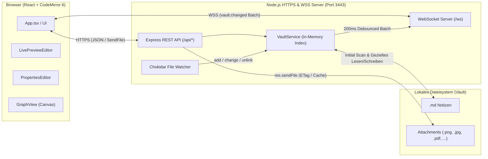

# System-Architektur & Backend (`server/` & `shared/`)

Dieses Dokument beschreibt die Backend-Architektur, den In-Memory-Index des `VaultService`, die Link- und Bildauflösung, die Echtzeit-Synchronisation sowie Authentifizierung und TLS.

---

## 1. Gesamtübersicht & Datenfluss



---

## 2. `VaultService` (`server/vaultService.ts`) – Der In-Memory-Index

### Warum ein In-Memory-Index?
In Node.js läuft JavaScript in einem einzigen Thread (Event-Loop). Wenn ein Vault z. B. 1.800 Dateien enthält und der Server bei jedem Aufruf von `/api/vault/graph`, `/api/vault/tree` oder `/api/vault/attachment` rekursiv das Dateisystem durchsucht oder alle `.md`-Dateien neu parst, blockiert der Event-Loop für mehrere Sekunden. Während dieser Blockade können selbst lokale Bild-Streams (`res.sendFile`) nur stückweise (in 64-KB-Chunks) ausgeliefert werden.

Deshalb liest `VaultService` den Vault **einmalig beim Start** (`rebuildIndex()`, dauert bei ~1.800 Dateien ca. 85 ms) vollständig in den Arbeitsspeicher und hält ihn danach **inkrementell** aktuell.

### interne Datenstrukturen von `VaultService`

| Feld | Typ | Beschreibung |
| :--- | :--- | :--- |
| `files` | `Map<string, FileEntry>` | Alle Dateien im Vault (Markdown & Anhänge), geschlüsselt nach relativem Pfad (z. B. `"Projekte/Plan.md"`). Enthält `path`, `name`, `basename`, `extension`, `mtimeMs`. |
| `notes` | `Map<string, NoteData>` | Alle geparsten `.md`-Notizen inkl. `frontmatter`, `properties`, `body`, `links`, `embeds`, `tags`, `headings` und `updatedAt` (`mtimeMs`). |
| `folders` | `Set<string>` | Alle bekannten relativen Ordnerpfade im Vault (ohne versteckte Punkt-Ordner wie `.obsidian` oder `.git`). |
| `lowerPathIndex` | `Map<string, string>` | $O(1)$-Lookup von kleingeschriebenem Pfad (mit und ohne `.md`-Endung) auf den exakten relativen Pfad in `files`. |
| `nameIndex` | `Map<string, string[]>` | $O(1)$-Lookup von kleingeschriebenem Dateinamen bzw. Basename auf eine sortierte Liste passender Dateipfade (`.md`-Dateien zuerst, danach kürzester Pfad zuerst – analog zu Obsidian). |
| `aliasIndex` | `Map<string, string>` | $O(1)$-Lookup von kleingeschriebenem Frontmatter-Alias (`aliases` / `alias`) auf den Notizpfad. |
| `treeCache` | `FileTreeNode[] \| null` | Gecachter hierarchischer Dateibaum für `/api/vault/tree`. Wird nur invalidiert, wenn sich die Ordner-/Dateistruktur ändert (`structural = true`). |
| `graphCache` | `GraphData \| null` | Gecachter globaler Wissensgraph (`nodes`, `edges`, `tags`). Wird bei Notizänderungen invalidiert (`this.graphCache = null`) und beim nächsten Abruf in ~4 ms aus `this.notes` neu berechnet. |

### Cache-Invalidierung (`invalidate(structural: boolean)`)
- Bei **Inhaltsänderungen** einer bestehenden Datei (`saveNote`, Chokidar `change`):
  - Nur diese eine Datei wird via `indexFile(relPath)` neu gelesen und geparst (< 0,2 ms).
  - `graphCache = null`, `lookupDirty = true`. `treeCache` bleibt erhalten!
- Bei **Strukturänderungen** (neue Datei, gelöschte Datei, neuer Ordner, Umbenennung):
  - `graphCache = null`, `lookupDirty = true`, `treeCache = null`.

---

## 3. Auflösung von Links und Anhängen (`resolveWikiTarget`)

Obsidian-Vaults verwenden in der Praxis unterschiedliche Schreibweisen für Verweise und Bilder:
1. **Wiki-Links & Wiki-Embeds:** `[[Projekt-Architektur]]`, `[[Ordner/Notiz|Alias]]`, `![[diagramm.svg]]`, `![[bild.png|400]]`
2. **Standard-Markdown-Links & -Bilder mit URL-Codierung:** ``
3. **Ordner-relative Pfade:** `` oder `[PDF](attachments/Datei.pdf)` innerhalb einer Notiz `Projekte/3d Drucker/Notiz.md`.

> [!WARNING]
> In großen Vaults heißen hunderte Bilder in verschiedenen Unterordnern gleich (z. B. `attachments/image1.png`). Daher akzeptiert `resolveWikiTarget(target: string, fromNotePath?: string)` als zweiten Parameter den Pfad der aktuell geöffneten Notiz (`fromNotePath`).

### Auflösungs-Reihenfolge in `resolveWikiTarget(target, fromNotePath)`
1. **URL-Dekodierung & Bereinigung:** `decodeURIComponent(target)`, Entfernen von `#heading`-Ankern, führenden `./` oder `/`.
2. **Stufe 0 – Relativ zum Ordner von `fromNotePath`:**
   Wenn `fromNotePath` übergeben wurde (z. B. `"Projekte/3d Drucker/Notiz.md"`) und `target` z. B. `"attachments/image11.jpeg"` lautet, wird zuerst `"projekte/3d drucker/attachments/image11.jpeg"` in `lowerPathIndex` geprüft.
3. **Stufe 1 – Exakter Pfad im Vault:**
   Prüfung in `lowerPathIndex.get(lower)` (findet sowohl `"Ordner/Notiz.md"` als auch `"Ordner/Notiz"`).
4. **Stufe 2 – Dateiname / Basename (`nameIndex`):**
   Gibt es mehrere Dateien mit demselben Namen (z. B. `image1.png`), wird – falls `fromNotePath` bekannt ist – ein Treffer im selben Ordner-Teilbaum bevorzugt, ansonsten gewinnt der kürzeste Pfad im Vault.
5. **Stufe 3 – Frontmatter-Alias (`aliasIndex`):**
   Prüft, ob eine Notiz das Ziel unter `aliases` im Frontmatter definiert hat.
6. **Stufe 4 – Teilpfad-Suffix:**
   Prüft Kandidaten in `nameIndex`, deren Pfad auf `/${lower}` oder `/${lower}.md` endet (ebenfalls mit Vorrang für den Teilbaum von `fromNotePath`).

---

## 4. Backlinks-Berechnung (`getBacklinks(targetPath)`)

Statt bei jedem Graph-Aufruf eine $O(N^2)$-Matrix über alle Notizen hinweg zu berechnen, werden Backlinks gezielt für die aktuell geöffnete Notiz über `GET /api/vault/backlinks?path=...` (Dauer: ~3 ms) ermittelt:
1. **Verlinkte Erwähnungen (`linked`):**
   Iteriert über `this.notes.values()`, prüft per `note.links.filter(l => this.resolveWikiTarget(l, note.path) === targetPath)`, ob die Notiz auf `targetPath` verweist, und extrahiert die betreffende Zeile als Snippet.
2. **Unverlinkte Erwähnungen (`unlinked`):**
   Sucht nach dem Titel (und eventuellen `aliases`) der Zielnotiz (sofern $\ge 4$ Zeichen lang) als eigenständiges Wort per Unicode-Regex `(?<![\p{L}\p{N}])(?:...)(?![\p{L}\p{N}])` in allen anderen Notizen, die noch nicht verlinkt sind.

---

## 5. Dateisystem-Watcher & WebSocket-Batching

1. `VaultService.startWatcher` startet `chokidar.watch(this.vaultDir)` und ignoriert alle versteckten Punkt-Dateien/Ordner (`/(^|[/\\])\../`, also `.obsidian`, `.git` etc.).
2. Bei jedem Datei-Event (`add`, `change`, `unlink`, `addDir`, `unlinkDir`) wird der In-Memory-Index sofort inkrementell aktualisiert.
3. **Batching (`queueNotification`):**
   Damit bei externen Massen-Updates (z. B. `git pull` oder Syncthing) nicht hunderte einzelne WebSocket-Nachrichten das Frontend überfluten, sammelt `VaultService` alle geänderten Pfade über ein **200-ms-Zeitfenster** in `pendingPaths` und feuert anschließend **eine einzige** gebündelte Nachricht:
   ```json
   {
     "type": "vault:changed",
     "paths": ["Projekte/Notiz.md"],
     "structural": false,
     "timestamp": 1792181000000
   }
   ```

---

## 6. Sicherheit: TLS/HTTPS, CORS & Dynamische Authentifizierung

### TLS / HTTPS (`server/tls.ts`)
- Ist `ENABLE_HTTPS=true` (Standard in `.env`), nutzt der Server HTTPS.
- Sind `TLS_CERT_PATH` und `TLS_KEY_PATH` in `.env` gesetzt und vorhanden, werden diese geladen.
- Andernfalls prüft `ensureTlsCredentials` das Verzeichnis `./certs/`. Fehlen `server.crt` oder `server.key`, erzeugt der Server automatisch per `openssl req -x509 -newkey rsa:2048` ein 10 Jahre gültiges Self-Signed-Zertifikat für `DNS:localhost,IP:127.0.0.1`.

### Dynamische Passwort- & Sicherheitskonfiguration (`server/configService.ts`)
- Zuber speichert Sicherheitseinstellungen persistent in `server-config.json` im Projekt-Root (`{ authEnabled: boolean, passwordHash: string, salt: string, updatedAt: number }`).
- Beim ersten Start ohne `server-config.json` wird das Initialpasswort aus `process.env.PASSWORD || process.env.ZUBER_PASSWORD || process.env.KNOWMESH_PASSWORD || process.env.OBSIDIAN_WEB_PASSWORD || 'zuber'` mit `crypto.scryptSync(password, salt, 64)` gehasht.
- Über `GET /api/settings/security` und `POST /api/settings/security` kann der Benutzer im UI das Passwort ändern oder den Passwortschutz komplett deaktivieren (`authEnabled: false`).
- Ist `authEnabled === false`, lässt `authMiddleware` alle Requests ohne Token durch (`GET /api/auth/status` antwortet mit `{ authenticated: true, authRequired: false }`).

### CORS & Multi-Origin Support (`server/index.ts`)
- Da Zuber als PWA auf mehreren Geräten installiert werden und sich mit entfernten Zuber-Servern verbinden kann, erlaubt die CORS-Middleware Cross-Origin-Anfragen (`origin: true`, `credentials: true`, `methods: GET, POST, PUT, DELETE, OPTIONS`, `allowedHeaders: Content-Type, Authorization`).

### Authentifizierungs-Token (`server/auth.ts`)
- Bei erfolgreichem Login (`POST /api/auth/login`) oder Passwort-Update erzeugt `createSessionToken()` ein 30 Tage gültiges JSON-Payload (`{ user: 'owner', iat, exp }`), Base64URL-codiert und mit `HMAC-SHA256` signiert.
- Das Token wird als HTTP-Only-Cookie (`zuber_session`) gesetzt und im JSON-Response zurückgegeben (vom Frontend in `localStorage` unter `zuber_token` gespeichert).
- `extractTokenFromRequest(req)` akzeptiert das Token aus:
  1. Header `Authorization: Bearer <token>` (bevorzugt für Cross-Origin PWA)
  2. Cookie `zuber_session` (oder `knowmesh_session` / `basalt_session` / `obsidian_vault_session` als Legacy-Fallback)
  3. Query-Parameter `?token=<token>` (für ``-Tags und WebSocket `/ws?token=...`)
- Die Signaturprüfung in `verifySessionToken` nutzt `crypto.timingSafeEqual`, um Timing-Angriffe auszuschließen.

---

## 7. Sync-Manifest, Batch-Download & Konflikterkennung (`VaultService`)

### Sync-Manifest (`GET /api/vault/sync-manifest`)
- Liefert $O(N)$ blitzschnell aus dem In-Memory-Index (`this.files`) alle Dateien im Vault mit Pfad, Typ (`markdown` oder `attachment`), Zeitstempel (`mtime`) und Dateigröße (`size`).
- Verhindert teure Dateisystem-Scans und ermöglicht dem PWA-Client einen effizienten Delta-Vergleich.

### Notizen-Batch (`POST /api/vault/notes-batch`)
- Erlaubt das gebündelte Abrufen mehrerer Markdown-Notizen über ein einzelnes Array von Pfaden (`{ paths: string[] }`).
- Alle angeforderten Notizen werden direkt aus dem In-Memory-Index (`this.notes`) in Millisekunden zurückgegeben (`{ notes: NoteData[] }`).

### Konflikterkennung & HTTP 409 Conflict (`POST /api/vault/note`)
- Client-Requests können `baseMtime?: number` und `forceOverwrite?: boolean` übergeben.
- Existiert die Datei auf dem Server bereits und weicht `baseMtime` um mehr als 50 ms vom aktuellen Server-Stand (`updatedAt`) ab, lehnt der Server das Überschreiben ab und antwortet mit **HTTP `409 Conflict`**:
  ```json
  {
    "error": "Conflict",
    "serverNote": { "path": "Notiz.md", "updatedAt": 1792182000000, ... }
  }
  ```
- Sendet der Client `forceOverwrite: true`, wird die Datei unabhängig von `baseMtime` überschrieben.

### Outbox-Verarbeitung, Post-Login-Sync & Reconnect (`flushOutbox()`, `notifyAuthenticatedOnline()`)
- Nach erfolgreichem Login (`handleLogin`) oder positivem Auth-Check beim Start (`initAuth`) ruft das Frontend sofort `syncEngine.notifyAuthenticatedOnline()` auf, damit `SyncEngine` unmittelbar aus dem initialen `offline`-Zustand in den Online-Sync wechselt und auf neuen Geräten (z. B. neu verbundenes Chromebook) sofort den Server-Vault lädt.
- Alle im Offline-Modus durchgeführten Datei- und Ordneroperationen (`save_note`, `create_folder`, `rename`, `delete`) werden in der lokalen IndexedDB-Outbox (`localDb.ts`) persistiert und über `localDb.reconcileTreeWithLocalState()` verlustfrei mit dem lokalen Dateibaum abgeglichen.
- Bei Reconnect (`online`-Event, WebSocket-Open oder periodischer Reconnect-Probe) verarbeitet `syncEngine.flushOutbox()` die Warteschlange:
  - Bei `save_note` holt der Sync-Engine stets das aktuellste Notizen-Objekt (`localDb.getNote(path)`), sodass alle offline getätigten Eingaben (`body`, `properties`, `rawContent`) vollständig übertragen werden.
  - Mutationen werden erst nach erfolgreichem Server-HTTP 200 aus der Outbox gelöscht.
  - Nach Abschluss der Outbox-Flutung erfolgt ein Delta-Manifest-Abgleich und das Frontend aktualisiert den Verzeichnisbaum (`loadVaultIndex()`).

### WebSocket Live-Tree Events
- Der WebSocket-Server sendet bei jeder Dateiänderung im Vault Nachrichten vom Typ `vault:changed` (sowie chokidar-Events wie `add`, `unlink`, `addDir`, `unlinkDir`).
- Der Client reagiert darauf mit einem sofortigen und debouncten Reload des Vault-Index (`loadVaultIndex()`), wodurch die Dateibaum-Ansicht (`FileSidebar`) für alle verbundenen Clients konsistent und aktuell bleibt.

---

## 8. Deployment mit Docker, Codeberg & Nginx Proxy Manager (NPM)

Zuber verfügt über eine vollständig gehärtete Architektur für das Hosting im öffentlichen Internet hinter einem Reverse Proxy.

### 8.1 Sicherheits-Mechanismen im Internetbetrieb
- **Reverse-Proxy Support (`trust proxy`):** Express wertet `X-Forwarded-For` für Client-IPs und `X-Forwarded-Proto` für HTTPS aus (aktiviert über `TRUST_PROXY=true`).
- **In-Memory Rate Limiting (`server/rateLimiter.ts`):**
  - Login-Route: max. 5 fehlgeschlagene Versuche pro 15 Minuten pro IP (HTTP 429).
  - API-Routen: max. 600 Requests pro Minute pro IP.
- **Server-seitige Session-Invalidierung & `sessionEpoch`:**
  - Jedes HMAC-Token enthält die aktuelle `sessionEpoch`. Bei Passwortänderung oder Global Logout (`POST /api/auth/logout` mit `{ revokeAll: true }`) wird `sessionEpoch` inkrementiert, wodurch alle zuvor ausgestellten Tokens serverseitig mit sofortiger Wirkung ungültig werden.
- **`FORCE_AUTH=true`:** Verhindert im Container-Betrieb, dass der Passwortschutz versehentlich über das Web-UI deaktiviert wird.
- **XSS-Schutz mit DOMPurify:** Alle Markdown-HTML-Renderings (`LivePreviewEditor.tsx`) werden strikt bereinigt (`DOMPurify.sanitize`).
- **HTTP Security Headers & Attachment-Sandboxing:**
  - `Referrer-Policy: no-referrer` (Token-Schutz bei Klicks auf externe Links).
  - `X-Content-Type-Options: nosniff`, `X-Frame-Options: SAMEORIGIN`.
  - Gefährliche Dateianhänge (z. B. `.html`, `.svg`) werden unter `Content-Security-Policy: sandbox` ausgeliefert.

### 8.2 Docker & Nginx Proxy Manager (NPM) Setup
- **Docker Compose:**
  - Image: `codeberg.org/waring/zuber:latest`
  - Volumes: `./vault:/data/vault`, `./config:/data/config`
  - Umgebung: `ENABLE_HTTPS=false`, `TRUST_PROXY=true`, `FORCE_AUTH=true`, `PORT=3443`, `PASSWORD=dein_sicheres_passwort`
- **NPM Host Konfiguration:**
  - Scheme: `http`, Hostname: `zuber`, Port: `3443`
  - **Websockets Support:** Enabled
  - **Block Common Exploits:** Enabled
  - **SSL:** Let's Encrypt, Force SSL, HTTP/2, HSTS Enabled

---

## 9. Vault Git-Versionierung & Remote-Backup (`server/gitService.ts`)

Zuber enthält eine integrierte, containerisierte Git-Engine zur Versionierung des Vaults sowie verschlüsselte Remote-Backups auf Codeberg, GitHub oder GitLab via HTTPS.

### 9.1 Containerisierte Git-Laufzeit
- Das Zuber Docker-Image enthält das offizielle `git`-Paket (`RUN apk add --no-cache ... git`).
- Alle Git-Befehle werden direkt im Vault-Verzeichnis (`/data/vault` bzw. `VAULT_DIR`) ausgeführt.
- Auf dem Host-System muss kein Git installiert oder eingerichtet sein.
- Der Chokidar-Dateiwatcher von `VaultService` ignoriert das `.git`-Verzeichnis strikt (`/(^|[/\\])\.git([/\\]|$)/`), um Endlosschleifen bei Git-Operationen auszuschließen.

### 9.2 Sequentielle Queue & Kollisionsschutz (`runExclusive`)
- Git erzeugt bei Index-Operationen temporär eine `.git/index.lock`-Datei. Gleichzeitige Aufrufe (z. B. gleichzeitiger Auto-Commit und Status-Check) würden zu Fehlern führen.
- `GitService` serialisiert alle Git-Operationen über eine interne Promise-Queue (`runExclusive<T>()`).

### 9.3 Sichere Zugangsdaten & Maskierung (`maskCredentials`)
- **Keine Speicherung im Remote-URL auf der Platte:** Remote-URLs werden in der Konfiguration ohne eingebettetes Passwort gespeichert. Authentifizierte URLs werden nur flüchtig zur Laufzeit im Speicher konstruiert.
- **Client-Schutz:** Personal Access Tokens (PATs) werden über die API maskiert (`hasToken: true`, Token-Feld weggelassen).
- **Log- & Fehlerschutz:** Alle Konsolenausgaben, Exceptions und Fehlermeldungen durchlaufen `maskCredentials`, sodass Tokens und HTTPS-Credentials niemals in Logs oder UI-Meldungen erscheinen.

### 9.4 Auto-Commit & Session-Ende
- **Notizwechsel / Verlassen:** Wenn der Benutzer eine modifizierte Notiz verlässt (`openNoteByPath` in `src/App.tsx`), wird ein Auto-Commit (`auto: update <path>`) ausgelöst.
- **Sitzungsende:** Trennen sich alle aktiven WebSocket-Verbindungen (Browser geschlossen / Tab beendet), löst der Server nach einem 5-Sekunden-Debounce automatisch einen Commit (`auto: session closed`) und bei aktivem Remote-Backup einen Push aus.

---

## 10. Canvas-Architektur & Backend-Integration (`.canvas`)

Zuber behandelt `.canvas`-Dateien (Obsidian JSON Canvas Spezifikation 1.0) als erstklassige Bürger im Gesamtsystem – gleichwertig zu Standard-Markdown-Notizen:

### 10.1 Reines JSON-Format ohne Frontmatter
- Während Notizen (`.md`) mit YAML-Frontmatter (`--- ... ---`) serialisiert werden, bleiben `.canvas`-Dateien strikt reines JSON.
- `VaultService.saveNote()` erkennt `.canvas` und speichert den Textkörper (`body`) direkt ohne Frontmatter-Header ab.

### 10.2 Vollständige Indizierung (`extractCanvasLinksAndTags`)
- `VaultService.indexFile()` parst `.canvas`-Dateien und nutzt `extractCanvasLinksAndTags(rawJson)` aus `shared/markdownUtils.ts`:
  - **Knoten vom Typ `file`:** Der referenzierte relative Pfad wird als ausgehender Link (`links`) und Einbettung (`embeds`) registriert.
  - **Knoten vom Typ `text`:** Roher Markdown-Text wird auf `[[Wiki-Links]]`, `[MD-Links](...)` und `#tags` untersucht.
  - **Erweiterte Zuber-Shapes:** Auch benutzerdefinierte Formen mit `text` oder `label` werden nach Links durchsucht.
  - **Kantenbeschriftungen (`label`):** Auch Beschriftungen von Verbindungslinien können Wiki-Links enthalten.

### 10.3 Wissensgraph & Backlinks
- **Graph-Knoten:** `.canvas`-Dateien erscheinen im globalen und lokalen Graph (`buildGraph()`) als Knoten mit `type: 'canvas'` und `kind: 'canvas'`.
- **Kanten:** Alle aus dem Canvas extrahierten Wiki-Links werden zu regulären Kanten im Wissensgraph aufgelöst.
- **Backlinks (`getBacklinks`):** Wenn ein Canvas auf eine Notiz oder ein Attachment verweist, erscheint der Canvas in der Backlink-Liste der Zielnotiz mit einem aussagekräftigen Kontext-Snippet (z. B. `[Canvas Node (file)]: ...` oder `[Canvas Link]: ...`).

### 10.4 Refactoring & Pfadanpassung (`renameOrMove`)
- Beim Umbenennen oder Verschieben von Dateien im Vault durchsucht `VaultService.renameOrMove()` auch alle `.canvas`-Dateien.
- Datei-Referenzen (`node.file`) sowie Wiki-Links in Text-Knoten und Kanten-Labels werden atomar auf den neuen Pfad aktualisiert.

### 10.5 Offline-Synchronisation (`getSyncManifest`)
- Im Sync-Manifest (`GET /api/vault/sync-manifest`) werden `.canvas`-Dateien als `type: 'markdown'` klassifiziert.
- Dadurch werden sie von der clientseitigen `SyncEngine` (`localDb.ts`) vollständig im Offline-Cache vorgehalten und über die Outbox synchronisiert.

---

## 11. Diagnose, Logging & Echo-Unterdrückung (`server/logger.ts` & `src/utils/logger.ts`)

### 11.1 Server-Logging (`server/logger.ts`)
- **In-Memory Ring-Buffer:** Hält die jeweils letzten 1000 Log-Einträge im flüchtigen Speicher für blitzschnellen Abruf über `/api/logs` ($O(1)$).
- **Rotierende Logdatei:** Schreibt Einträge zusätzlich in `<configDir>/zuber.log`. Bei Überschreiten von 5 MB wird die Datei atomar zu `zuber.log.1` rotiert (max. 1 Backup), um Plattenplatz zu sparen.
- **Konfigurierbare Log-Stufen:** Unterstützt `debug`, `info`, `warn` und `error`. Das Level kann dynamisch zur Laufzeit geändert und in `server-config.json` persistiert werden.
- **Container-Transparenz:** Jeder Log-Eintrag wird parallel formatiert auf die Standardausgabe (`stdout`/`stderr`) ausgegeben (`docker logs`).

### 11.2 Client-Logging (`src/utils/logger.ts`)
- **Browser-Ring-Buffer:** Verwaltet bis zu 1000 strukturierte Log-Ereignisse im Arbeitsspeicher des Browsers.
- **Session-Persistenz:** Die letzten 200 Einträge werden in `sessionStorage` gespiegelt, sodass Logs auch nach einem versehentlichen Neuladen der Seite erhalten bleiben.
- **Globale Fehlererfassung:** Registriert automatische Listener für unhandled exceptions (`window.onerror`) und unhandled promise rejections (`window.onunhandledrejection`).

### 11.3 Echo-Unterdrückung & Falschkonflikt-Prävention
- **Content-Equality Check:** Weicht der Zeitstempel (`baseMtime`) um wenige Sekunden ab (z. B. durch Dateisystem-Rundung oder Latenz), aber der Inhalt (Markdown-Body und Frontmatter) ist 100 % identisch, wird kein `409 Conflict` geworfen, sondern der Speicheraufruf mit `200 OK` bestätigt.
- **Schutz vor leerem Puffer:** Versucht ein Client eine Notiz mit leerem Body zu speichern, während auf dem Server Inhalt existiert (typisch bei schnellem Notizwechsel oder Ladeverzögerungen), wird dies ohne `explicitClear: true` abgefangen und der Server-Zustand übernommen, anstatt Daten zu überschreiben.
- **Echo-Window (3000 ms):** Lokale Speicherungen und Bild-Uploads hinterlegen ihren Pfad in `recentSelfWritesRef`. Eintreffende `vault:changed`-WebSocket-Events für diesen Pfad innerhalb von 3 Sekunden werden ignoriert, um Echo-Schleifen zu verhindern.


