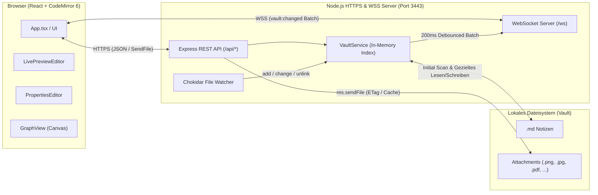

# System-Architektur & Backend (`server/` & `shared/`)

Dieses Dokument beschreibt die Backend-Architektur, den In-Memory-Index des `VaultService`, die Link- und Bildauflösung, die Echtzeit-Synchronisation sowie Authentifizierung und TLS.

---

## 1. Gesamtübersicht & Datenfluss



---

## 2. `VaultService` (`server/vaultService.ts`) – Der In-Memory-Index

### Warum ein In-Memory-Index?
In Node.js läuft JavaScript in einem einzigen Thread (Event-Loop). Wenn ein Vault z. B. 1.800 Dateien enthält und der Server bei jedem Aufruf von `/api/vault/graph`, `/api/vault/tree` oder `/api/vault/attachment` rekursiv das Dateisystem durchsucht oder alle `.md`-Dateien neu parst, blockiert der Event-Loop für mehrere Sekunden. Während dieser Blockade können selbst lokale Bild-Streams (`res.sendFile`) nur stückweise (in 64-KB-Chunks) ausgeliefert werden.

Deshalb liest `VaultService` den Vault **einmalig beim Start** (`rebuildIndex()`, dauert bei ~1.800 Dateien ca. 85 ms) vollständig in den Arbeitsspeicher und hält ihn danach **inkrementell** aktuell.

### interne Datenstrukturen von `VaultService`

| Feld | Typ | Beschreibung |
| :--- | :--- | :--- |
| `files` | `Map<string, FileEntry>` | Alle Dateien im Vault (Markdown & Anhänge), geschlüsselt nach relativem Pfad (z. B. `"Projekte/Plan.md"`). Enthält `path`, `name`, `basename`, `extension`, `mtimeMs`. |
| `notes` | `Map<string, NoteData>` | Alle geparsten `.md`-Notizen inkl. `frontmatter`, `properties`, `body`, `links`, `embeds`, `tags`, `headings` und `updatedAt` (`mtimeMs`). |
| `folders` | `Set<string>` | Alle bekannten relativen Ordnerpfade im Vault (ohne versteckte Punkt-Ordner wie `.obsidian` oder `.git`). |
| `lowerPathIndex` | `Map<string, string>` | $O(1)$-Lookup von kleingeschriebenem Pfad (mit und ohne `.md`-Endung) auf den exakten relativen Pfad in `files`. |
| `nameIndex` | `Map<string, string[]>` | $O(1)$-Lookup von kleingeschriebenem Dateinamen bzw. Basename auf eine sortierte Liste passender Dateipfade (`.md`-Dateien zuerst, danach kürzester Pfad zuerst – analog zu Obsidian). |
| `aliasIndex` | `Map<string, string>` | $O(1)$-Lookup von kleingeschriebenem Frontmatter-Alias (`aliases` / `alias`) auf den Notizpfad. |
| `treeCache` | `FileTreeNode[] \| null` | Gecachter hierarchischer Dateibaum für `/api/vault/tree`. Wird nur invalidiert, wenn sich die Ordner-/Dateistruktur ändert (`structural = true`). |
| `graphCache` | `GraphData \| null` | Gecachter globaler Wissensgraph (`nodes`, `edges`, `tags`). Wird bei Notizänderungen invalidiert (`this.graphCache = null`) und beim nächsten Abruf in ~4 ms aus `this.notes` neu berechnet. |

### Cache-Invalidierung (`invalidate(structural: boolean)`)
- Bei **Inhaltsänderungen** einer bestehenden Datei (`saveNote`, Chokidar `change`):
  - Nur diese eine Datei wird via `indexFile(relPath)` neu gelesen und geparst (< 0,2 ms).
  - `graphCache = null`, `lookupDirty = true`. `treeCache` bleibt erhalten!
- Bei **Strukturänderungen** (neue Datei, gelöschte Datei, neuer Ordner, Umbenennung):
  - `graphCache = null`, `lookupDirty = true`, `treeCache = null`.

---

## 3. Auflösung von Links und Anhängen (`resolveWikiTarget`)

Obsidian-Vaults verwenden in der Praxis unterschiedliche Schreibweisen für Verweise und Bilder:
1. **Wiki-Links & Wiki-Embeds:** `[[Projekt-Architektur]]`, `[[Ordner/Notiz|Alias]]`, `![[diagramm.svg]]`, `![[bild.png|400]]`
2. **Standard-Markdown-Links & -Bilder mit URL-Codierung:** ``
3. **Ordner-relative Pfade:** `` oder `[PDF](attachments/Datei.pdf)` innerhalb einer Notiz `Projekte/3d Drucker/Notiz.md`.

> [!WARNING]
> In großen Vaults heißen hunderte Bilder in verschiedenen Unterordnern gleich (z. B. `attachments/image1.png`). Daher akzeptiert `resolveWikiTarget(target: string, fromNotePath?: string)` als zweiten Parameter den Pfad der aktuell geöffneten Notiz (`fromNotePath`).

### Auflösungs-Reihenfolge in `resolveWikiTarget(target, fromNotePath)`
1. **URL-Dekodierung & Bereinigung:** `decodeURIComponent(target)`, Entfernen von `#heading`-Ankern, führenden `./` oder `/`.
2. **Stufe 0 – Relativ zum Ordner von `fromNotePath`:**
   Wenn `fromNotePath` übergeben wurde (z. B. `"Projekte/3d Drucker/Notiz.md"`) und `target` z. B. `"attachments/image11.jpeg"` lautet, wird zuerst `"projekte/3d drucker/attachments/image11.jpeg"` in `lowerPathIndex` geprüft.
3. **Stufe 1 – Exakter Pfad im Vault:**
   Prüfung in `lowerPathIndex.get(lower)` (findet sowohl `"Ordner/Notiz.md"` als auch `"Ordner/Notiz"`).
4. **Stufe 2 – Dateiname / Basename (`nameIndex`):**
   Gibt es mehrere Dateien mit demselben Namen (z. B. `image1.png`), wird – falls `fromNotePath` bekannt ist – ein Treffer im selben Ordner-Teilbaum bevorzugt, ansonsten gewinnt der kürzeste Pfad im Vault.
5. **Stufe 3 – Frontmatter-Alias (`aliasIndex`):**
   Prüft, ob eine Notiz das Ziel unter `aliases` im Frontmatter definiert hat.
6. **Stufe 4 – Teilpfad-Suffix:**
   Prüft Kandidaten in `nameIndex`, deren Pfad auf `/${lower}` oder `/${lower}.md` endet (ebenfalls mit Vorrang für den Teilbaum von `fromNotePath`).

---

## 4. Backlinks-Berechnung (`getBacklinks(targetPath)`)

Statt bei jedem Graph-Aufruf eine $O(N^2)$-Matrix über alle Notizen hinweg zu berechnen, werden Backlinks gezielt für die aktuell geöffnete Notiz über `GET /api/vault/backlinks?path=...` (Dauer: ~3 ms) ermittelt:
1. **Verlinkte Erwähnungen (`linked`):**
   Iteriert über `this.notes.values()`, prüft per `note.links.filter(l => this.resolveWikiTarget(l, note.path) === targetPath)`, ob die Notiz auf `targetPath` verweist, und extrahiert die betreffende Zeile als Snippet.
2. **Unverlinkte Erwähnungen (`unlinked`):**
   Sucht nach dem Titel (und eventuellen `aliases`) der Zielnotiz (sofern $\ge 4$ Zeichen lang) als eigenständiges Wort per Unicode-Regex `(?<![\p{L}\p{N}])(?:...)(?![\p{L}\p{N}])` in allen anderen Notizen, die noch nicht verlinkt sind.

---

## 5. Dateisystem-Watcher & WebSocket-Batching

1. `VaultService.startWatcher` startet `chokidar.watch(this.vaultDir)` und ignoriert alle versteckten Punkt-Dateien/Ordner (`/(^|[/\\])\../`, also `.obsidian`, `.git` etc.).
2. Bei jedem Datei-Event (`add`, `change`, `unlink`, `addDir`, `unlinkDir`) wird der In-Memory-Index sofort inkrementell aktualisiert.
3. **Batching (`queueNotification`):**
   Damit bei externen Massen-Updates (z. B. `git pull` oder Syncthing) nicht hunderte einzelne WebSocket-Nachrichten das Frontend überfluten, sammelt `VaultService` alle geänderten Pfade über ein **200-ms-Zeitfenster** in `pendingPaths` und feuert anschließend **eine einzige** gebündelte Nachricht:
   ```json
   {
     "type": "vault:changed",
     "paths": ["Projekte/Notiz.md"],
     "structural": false,
     "timestamp": 1792181000000
   }
   ```

---

## 6. Sicherheit: TLS/HTTPS, CORS & Dynamische Authentifizierung

### TLS / HTTPS (`server/tls.ts`)
- Ist `ENABLE_HTTPS=true` (Standard in `.env`), nutzt der Server HTTPS.
- Sind `TLS_CERT_PATH` und `TLS_KEY_PATH` in `.env` gesetzt und vorhanden, werden diese geladen.
- Andernfalls prüft `ensureTlsCredentials` das Verzeichnis `./certs/`. Fehlen `server.crt` oder `server.key`, erzeugt der Server automatisch per `openssl req -x509 -newkey rsa:2048` ein 10 Jahre gültiges Self-Signed-Zertifikat für `DNS:localhost,IP:127.0.0.1`.

### Dynamische Passwort- & Sicherheitskonfiguration (`server/configService.ts`)
- Knowmesh speichert Sicherheitseinstellungen persistent in `server-config.json` im Projekt-Root (`{ authEnabled: boolean, passwordHash: string, salt: string, updatedAt: number }`).
- Beim ersten Start ohne `server-config.json` wird das Initialpasswort aus `process.env.OBSIDIAN_WEB_PASSWORD || 'obsidian'` mit `crypto.scryptSync(password, salt, 64)` gehasht.
- Über `GET /api/settings/security` und `POST /api/settings/security` kann der Benutzer im UI das Passwort ändern oder den Passwortschutz komplett deaktivieren (`authEnabled: false`).
- Ist `authEnabled === false`, lässt `authMiddleware` alle Requests ohne Token durch (`GET /api/auth/status` antwortet mit `{ authenticated: true, authRequired: false }`).

### CORS & Multi-Origin Support (`server/index.ts`)
- Da Knowmesh als PWA auf mehreren Geräten installiert werden und sich mit entfernten Knowmesh-Servern verbinden kann, erlaubt die CORS-Middleware Cross-Origin-Anfragen (`origin: true`, `credentials: true`, `methods: GET, POST, PUT, DELETE, OPTIONS`, `allowedHeaders: Content-Type, Authorization`).

### Authentifizierungs-Token (`server/auth.ts`)
- Bei erfolgreichem Login (`POST /api/auth/login`) oder Passwort-Update erzeugt `createSessionToken()` ein 30 Tage gültiges JSON-Payload (`{ user: 'owner', iat, exp }`), Base64URL-codiert und mit `HMAC-SHA256` signiert.
- Das Token wird als HTTP-Only-Cookie (`knowmesh_session`) gesetzt und im JSON-Response zurückgegeben (vom Frontend in `localStorage` unter `knowmesh_token` gespeichert).
- `extractTokenFromRequest(req)` akzeptiert das Token aus:
  1. Header `Authorization: Bearer <token>` (bevorzugt für Cross-Origin PWA)
  2. Cookie `knowmesh_session` (oder `basalt_session` / `obsidian_vault_session` als Fallback)
  3. Query-Parameter `?token=<token>` (für ``-Tags und WebSocket `/ws?token=...`)
- Die Signaturprüfung in `verifySessionToken` nutzt `crypto.timingSafeEqual`, um Timing-Angriffe auszuschließen.

---

## 7. Sync-Manifest, Batch-Download & Konflikterkennung (`VaultService`)

### Sync-Manifest (`GET /api/vault/sync-manifest`)
- Liefert $O(N)$ blitzschnell aus dem In-Memory-Index (`this.files`) alle Dateien im Vault mit Pfad, Typ (`markdown` oder `attachment`), Zeitstempel (`mtime`) und Dateigröße (`size`).
- Verhindert teure Dateisystem-Scans und ermöglicht dem PWA-Client einen effizienten Delta-Vergleich.

### Notizen-Batch (`POST /api/vault/notes-batch`)
- Erlaubt das gebündelte Abrufen mehrerer Markdown-Notizen über ein einzelnes Array von Pfaden (`{ paths: string[] }`).
- Alle angeforderten Notizen werden direkt aus dem In-Memory-Index (`this.notes`) in Millisekunden zurückgegeben (`{ notes: NoteData[] }`).

### Konflikterkennung & HTTP 409 Conflict (`POST /api/vault/note`)
- Client-Requests können `baseMtime?: number` und `forceOverwrite?: boolean` übergeben.
- Existiert die Datei auf dem Server bereits und weicht `baseMtime` um mehr als 50 ms vom aktuellen Server-Stand (`updatedAt`) ab, lehnt der Server das Überschreiben ab und antwortet mit **HTTP `409 Conflict`**:
  ```json
  {
    "error": "Conflict",
    "serverNote": { "path": "Notiz.md", "updatedAt": 1792182000000, ... }
  }
  ```
- Sendet der Client `forceOverwrite: true`, wird die Datei unabhängig von `baseMtime` überschrieben.
