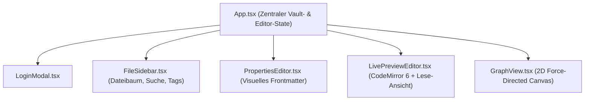
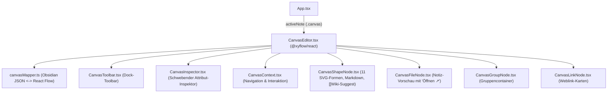

# Frontend & CodeMirror 6 Live-Preview Architecture (`doc/FRONTEND_AND_EDITOR.md`)

Dieses Dokument beschreibt den Aufbau des React-Frontends (`src/`) und insbesondere die Funktionsweise des **CodeMirror 6 Live-Preview Editors** ([`src/components/LivePreviewEditor.tsx`](../src/components/LivePreviewEditor.tsx)).

---

## 1. Komponenten-Überblick & Datenfluss



### 1.1 Zentraler State in [`src/App.tsx`](../src/App.tsx)

`App.tsx` hält den gesamten Anwendungszustand zusammen:

- **Authentifizierung:** `authChecked`, `authenticated`, `authRequired`
- **Vault-Übersicht:**
  - `vaultName`: Name des Wurzelverzeichnisses
  - `tree`: Hierarchischer `FileNode[]`-Baum für die linke Seitenleiste
  - `allNotes`: Flache Liste aller Markdown-Notizen (`Array<{ path, name, folder }>`) für schnelles `[[`-Autovervollständigen und den Schnellöffner (`Ctrl/Cmd + O`)
  - `tags`: Alle im Vault vorkommenden `#tags` mit Häufigkeitszähler
- **Aktive Notiz & Tabs:**
  - `openTabs`: Liste der geöffneten Notizpfade (`string[]`), persistiert in `localStorage` (`knowmesh_open_tabs`)
  - `activeNote`: Aktuell geladenes `NotePayload`-Objekt
  - `editorBody`: Aktueller Markdown-Text (ohne Frontmatter) im Editor
  - `editorProps`: Aktuelle `FrontmatterProperty[]`-Liste im visuellen Eigenschaften-Panel
  - `dirty`: `boolean` – gibt an, ob ungespeicherte Änderungen vorliegen
  - `saving`: `boolean` – gibt an, ob gerade ein Speicher-Request läuft
- **Ansichtsmodi:**
  - `editorMode`: `'live'` (Knowmesh Live-Preview) | `'source'` (Reiner Markdown-Quelltext) | `'reading'` (Komplett gerenderte HTML-Leseansicht)
  - `centerView`: `'editor'` (Standard) | `'graph'` (Vollbild-Graph im Hauptbereich)
  - `rightTab`: `'graph'` (Lokaler Nachbarschafts-Graph in der rechten Seitenleiste) | `'backlinks'` (Eingehende & ausgehende Verweise) | `'outline'` (Gliederung nach Überschriften)

### 1.2 Auto-Save & Schutz vor Race-Conditions

1. **Debounced Auto-Save (700 ms):**
   Jede Änderung am Markdown-Text (`handleBodyChange`) oder an den Eigenschaften (`handlePropertiesChange`) setzt `dirty = true` und startet einen `700ms`-Timer (`saveTimerRef`). Nach Ablauf ruft `persistNote(path, body, props)` `api.saveNote()` auf.
2. **Sofortiges Speichern vor Notizwechsel:**
   Wenn der Benutzer in [`openNote(targetPath)`](../src/App.tsx) zu einer anderen Notiz wechselt, während `dirty === true` ist, wird ein ausstehender Timer abgebrochen und die aktuelle Notiz **vor** dem Laden der neuen Notiz gespeichert.
3. **Unterdrückung von Echo-Reloads (`lastLocalSaveRef`):**
   Wenn `persistNote` speichert, wird `lastLocalSaveRef.current = Date.now()` gesetzt. Trifft innerhalb von `1500ms` danach eine WebSocket-Nachricht `vault:changed` für dieselbe Datei ein, wird das erneute Laden übersprungen, damit der Cursor im Editor nicht springt.

---

## 2. Der CodeMirror 6 Live-Preview Editor ([`src/components/LivePreviewEditor.tsx`](../src/components/LivePreviewEditor.tsx))

Der Editor bildet das Herzstück der Applikation und implementiert ein modernes **Live-Preview-Konzept**:
- Solange sich der **Cursor (oder die Textauswahl) außerhalb** eines Markdown-Elements befindet, werden Steuerzeichen (`#`, `**`, `*`, `~~`, `[[...]]`, `![[...]]`, ``, Tabellen-Pipes `|`) ausgeblendet (`Decoration.replace({})`) oder durch interaktive Widgets ersetzt.
- Sobald der **Cursor in die Zeile bzw. den Bereich** des Elements bewegt wird, klappt das Element automatisch in seinen rohen Markdown-Quelltext auf, sodass es direkt bearbeitet werden kann.

### 2.1 Performance: Viewport-Windowing

Bei sehr langen Notizen wäre das Erzeugen von tausenden DOM-Widgets im gesamten Dokument zu langsam. Deshalb berechnet [`buildLivePreviewDecorations(view)`](../src/components/LivePreviewEditor.tsx) Dekorationen nur für die aktuell sichtbaren Bereiche (`view.visibleRanges`) mit einem Sicherheitspuffer von **$\pm 1500$ Zeichen**:

```ts
const vpFrom = Math.max(0, view.viewport.from - 1500);
const vpTo = Math.min(docLength, view.viewport.to + 1500);
```

### 2.2 Übersicht aller Live-Preview-Dekorationen & Widgets

| Markdown-Element | Cursor außerhalb | Cursor innerhalb | Implementierung in `LivePreviewEditor.tsx` |
| :--- | :--- | :--- | :--- |
| **Überschriften** (`# H1` .. `###### H6`) | `### ` wird ausgeblendet, Zeile erhält `.cm-lp-h1` .. `.cm-lp-h6` | `### ` wird mit `.cm-lp-formatting` gedimmt eingeblendet | Zeilen-Scan + `selectionTouchesLine` |
| **Blockquotes** (`> Zitat`) | Zeile erhält `.cm-lp-blockquote` (linker Akzentbalken) | Bleibt `.cm-lp-blockquote` | Zeilen-Scan |
| **Horizontale Linie** (`---`, `***`) | Ersetzt durch `<hr class="cm-lp-hr" />` (`HrWidget`) | Rohes `---` sichtbar | Zeilen-Scan + `selectionTouchesLine` |
| **Aufgabenlisten** (`- [ ] `, `- [x] `) | `- [ ]` wird durch interaktives `<input type="checkbox">` (`CheckboxWidget`) ersetzt. Klick schaltet `[ ]` $\leftrightarrow$ `[x]` direkt im Dokument um! | `- [ ]` als Text sichtbar | Zeilen-Scan + `CheckboxWidget` |
| **Aufzählungslisten** (`- `, `* `, `+ `) | `-` wird durch einen gestylten Listenpunkt `•` (`BulletWidget`) ersetzt | `-` als Text sichtbar | Zeilen-Scan + `BulletWidget` |
| **Codeblöcke** (` ```lang ... ``` `) | Alle Zeilen erhalten `.cm-lp-codeblock-line` (dunkler Hintergrund, Monospace) | Öffnende/schließende ` ``` `-Zeilen sind außerhalb gedimmt | Mehrzeilen-Zustandsautomat (`inCodeFence`) |
| **Markdown-Tabellen** (`\| A \| B \|`) | Erste Zeile wird durch gerendertes HTML-`<table>` (`TableWidget`) ersetzt; Folgezeilen der Tabelle werden per `.cm-lp-table-collapsed-line` ausgeblendet. Klick auf die Tabelle setzt den Cursor hinein zum Bearbeiten. | Kompletter Markdown-Tabellenquelltext sichtbar (`.cm-lp-table-source-line`) | Mehrzeilen-Tabellen-Detektor (`isTableRow`, `isTableSeparator`) + `TableWidget` |
| **Wiki-Embeds** (`![[bild.png\|400]]`, `![[doc.pdf]]`) | Ersetzt durch `EmbedWidget` (`` mit Lazy-Loading, `<audio>`, `<video>`, PDF-Karte oder Notiz-Einbettung) | Roher Code `![[...]]` sichtbar | Regex `WIKI_REGEX` + `selectionTouches` |
| **Wiki-Links** (`[[Ziel\|Alias]]`) | Ersetzt durch klickbares `WikiLinkWidget` (`<span class="cm-lp-wikilink">`). Klick öffnet die Zielnotiz! | Roher Code `[[Ziel\|Alias]]` sichtbar | Regex `WIKI_REGEX` + `WikiLinkWidget` |
| **Markdown-Bilder** (``) | Ersetzt durch `EmbedWidget` (übergibt auch `currentNotePath` für relative Pfade wie `attachments/img.png` und `decodeURIComponent` für `%20`) | Roher Code `` sichtbar | Regex `MD_LINK_REGEX` (`isEmbed === true`) |
| **Markdown-Links** (`[Text](Ziel.md)` oder `[Web](https://...)`) | Ersetzt durch `WikiLinkWidget` (interne Links öffnen die Notiz/Datei; externe Links öffnen im neuen Browser-Tab mit `↗`) | Roher Code `[Text](...)` sichtbar | Regex `MD_LINK_REGEX` (`isEmbed === false`) |
| **Fettdruck** (`**Text**`) | `**` wird ausgeblendet, Text erhält `.cm-lp-bold` | `**` sichtbar | Regex `BOLD_REGEX` |
| **Kursiv** (`*Text*`) | `*` wird ausgeblendet, Text erhält `.cm-lp-italic` | `*` sichtbar | Regex `ITALIC_REGEX` |
| **Durchgestrichen** (`~~Text~~`) | `~~` wird ausgeblendet, Text erhält `.cm-lp-strike` | `~~` sichtbar | Regex `STRIKE_REGEX` |
| **Highlight** (`==Text==`) | `==` wird ausgeblendet, Text erhält `.cm-lp-highlight` (gelbe Markierung) | `==` sichtbar | Regex `HIGHLIGHT_REGEX` |
| **Inline-Code** (`` `code` ``) | Backticks ausgeblendet, Text erhält `.cm-lp-inline-code` | Backticks sichtbar | Regex `INLINE_CODE_REGEX` |
| **Tags** (`#tag/subtag`) | Ersetzt durch klickbares `TagPillWidget` (`#tag/subtag`). Klick filtert nach diesem Tag! | Roher Text `#tag/subtag` sichtbar | Regex `TAG_REGEX` |

> [!WARNING]
> **Wichtige CodeMirror-6-Einschränkung bei mehrzeiligen Dekorationen:**
> Ein `ViewPlugin` darf in CodeMirror 6 **niemals** `Decoration.replace(...)` über Zeilenumbrüche (`\n`) hinweg verwenden (führt sofort zum Fehler `RangeError: Decorations that replace line breaks may not be specified via plugins`).
> Deshalb rendert unser Tabellen-Detektor das `TableWidget` als `Decoration.widget({ widget: new TableWidget(tableLines) })` am Anfang der ersten Tabellenzeile und kollabiert die einzelnen Tabellenzeilen zeilenweise mit `Decoration.line({ class: 'cm-lp-table-collapsed-line' })` (`font-size: 0; line-height: 0; height: 0; overflow: hidden`).

### 2.3 Wiki-Link (`[[`) und Tag (`#`) Autovervollständigung

Die Funktion [`wikiLinkCompletion`](../src/components/LivePreviewEditor.tsx) ist bei `@codemirror/autocomplete` registriert:
- Tippt der Benutzer `[[` gefolgt von beliebigen Zeichen, durchsucht die Funktion `allNotesRef.current` nach passenden Notiznamen und Pfaden (bis zu 30 Vorschläge) und vervollständigt beim Bestätigen automatisch zu `[[Notizname]]`.
- Tippt der Benutzer `#` nach einem Leerzeichen oder am Zeilenanfang, schlägt die Funktion existierende Tags aus `allTagsRef.current` vor.

### 2.4 Drag & Drop, Zwischenablage-Upload und Bild-Einfügen in EditorToolbar

Der `EditorView.domEventHandlers`-Hook fängt `drop`- und `paste`-Events ab; zusätzlich steht in der Formatierungs-Toolbar (`EditorToolbar`) der Button **Bild einfügen** (Dateiauswahl oder Kamera-Foto) zur Verfügung:
- Sowohl Clipboard-Items (`event.clipboardData.items`), Clipboard-Dateien (`event.clipboardData.files`), Drag & Drop-Dateien (`event.dataTransfer.files`) als auch die Dateiauswahl per Button unterstützen Einzel- und Mehrfach-Uploads.
- Bei Blobs aus der Zwischenablage ohne Dateiendung wird der MIME-Typ analysiert (`image/png`, `image/jpeg` etc.), sodass auf dem Server stets eine gültige Dateiendung vergeben wird.
- Die Datei wird nach `/api/vault/upload?folder=attachments` hochgeladen und an der aktuellen Cursorposition bzw. am Ende der Notiz automatisch als fertiger Wiki-Embed-Tag `![[attachments/dateiname.png]]` eingefügt.
- Die CodeMirror-Dekoration (`EmbedWidget`) erkennt die Bild-Syntax sofort und rendert die Grafik direkt im Live-Preview-Modus.

### 2.5 Interaktive Bildanpassung (Größenänderung per Maus & Ausrichtung via HTML-Attribute)

Für maximale Kompatibilität mit Standard-Markdown-Readern, GitHub Flavored Markdown und Webviewern speichert Knowmesh Bildgrößen und -ausrichtungen nicht über proprietäre Syntax, sondern über Standard-HTML-Attribute:
``

- **Interaktiver Auswahl-Rahmen:** Ein Klick auf ein gerendertes Bild im Live-Preview-Modus selektiert das Bild (`selected = true`) und blendet eine schwebende Schnellzugriffs-Toolbar sowie Größenanfasser (Drag-Handles) ein.
- **Größenänderung mit der Maus (Drag Handle):**
  - An den unteren Ecken (Südost `se-resize` und Südwest `sw-resize`) befinden sich Drag-Handles.
  - Beim Ziehen mit gedrückter Maustaste wird die Bildbreite in Echtzeit skaliert und als numerische Pixelanzeige im Badge visualisiert (unter Wahrung der Aspekt-Ratio).
  - Beim Loslassen der Maustaste wird das Markdown-Dokument atomar aktualisiert (oder von Wiki-Embed `![[...]]` in `` überführt).
- **Ausrichtungs-Toolbar (`align`):**
  - **Links:** `align="left"` (Fließtext rechts um das Bild)
  - **Zentriert:** `align="center"` (zentrierter Block)
  - **Rechts:** `align="right"` (Fließtext links um das Bild)
  - **Inline:** entfernt das `align`-Attribut
  - **Größe zurücksetzen:** Setzt die Breite auf Originalgröße zurück.
- **Unterstützung im Lese-Modus (`reading`):**
  - Auch in `preprocessObsidianMarkdown` und `marked` werden `` Tags vollständig mit passendem CSS-Styling (Float bzw. zentrierte Blockdarstellung) gerendert.

### 2.6 Lese-Ansicht (`mode === 'reading'`)

Im Lese-Modus wird anstelle von CodeMirror `marked` (mit aktiviertem GitHub Flavored Markdown `gfm: true` für Tabellen, Aufgabenlisten und Durchstreichungen) nach einer Vorverarbeitung durch [`preprocessObsidianMarkdown`](../src/components/LivePreviewEditor.tsx) gerendert. Klicks auf interne Links und Tags werden per Event-Delegation (`data-wiki-target`, `data-tag`) abgefangen.

---

## 3. Visueller Eigenschaften-Editor ([`src/components/PropertiesEditor.tsx`](../src/components/PropertiesEditor.tsx))

Wie vom Benutzer gewünscht, wird YAML-Frontmatter niemals als roher YAML-Quelltext im Editor angezeigt. Stattdessen sitzt oberhalb des Editors das einklappbare Panel **"Eigenschaften"**:

- Jede Eigenschaft besteht aus:
  1. **Typ-Umschalter Button** (Icon links: `Aa` Text, `#` Zahl, `☑` Checkbox, `📅` Datum, `≡` Liste, `🏷` Tags) – Klick wechselt zyklisch den `PropertyType` und konvertiert den Wert passend.
  2. **Schlüssel-Eingabefeld** (`key`).
  3. **Typspezifisches Wert-Eingabefeld:**
     - `'text'` $\rightarrow$ `<input type="text">`
     - `'number'` $\rightarrow$ `<input type="number">`
     - `'checkbox'` $\rightarrow$ `<input type="checkbox">`
     - `'date'` $\rightarrow$ `<input type="date">`
     - `'list'` / `'tags'` $\rightarrow$ Chip-/Pill-Liste mit `×`-Button zum Entfernen einzelner Einträge und `Enter`/`Komma`-Eingabe zum Hinzufügen neuer Werte.
  4. **Löschen-Button (`×`)** zum Entfernen der Eigenschaft.
- Über **"+ Eigenschaft hinzufügen"** oder die Schnell-Buttons (`+ tags`, `+ aliases`, `+ status`) können neue Frontmatter-Felder angelegt werden.

---

## 4. Interaktive Graph-Ansicht ([`src/components/GraphView.tsx`](../src/components/GraphView.tsx))

Die Graph-Ansicht nutzt ein performantes HTML5 `<canvas>` mit screen-space Rendering und eigener $O(N)$ Kräftesimulation, optimiert für große Vaults mit 1.800+ Notizen:

- **Semantischer Zoom & Screen-Space Rendering (kein globales `ctx.scale`):**
  - Der Zoom-Faktor `scale` (`0.08` bis `6.0`) skaliert primär den räumlichen Abstand zwischen den Knoten (`(node.x - viewCenterX) * scale + canvasWidth / 2 + panX`), wodurch Knoten beim Hineinzoomen auseinanderdriften.
  - **Logarithmischer Knoten-Radius:**
    `baseRadius = 2.8 + Math.log(1 + degree) * 1.6;`
    `drawRadius = Math.min(14, Math.max(2.0, baseRadius * Math.pow(scale, 0.35) * nodeSizeMultiplier));`
    Knoten bleiben auf allen Zoomstufen elegante, scharfe Datenpunkte statt riesiger Bälle.
  - **Dezente Standardfarben & Hover-Spotlight:**
    - Normale Notizen: Dezent grau/slate (`#9ca3af`)
    - Aktive Notiz: Goldener Theme-Akzent (`#d4af37`) mit sanftem Scheinring
    - Nicht-erstellte Notizen (`type === 'unresolved'`): Gedimmtes Grau (Opacity 0.45)
    - Kanten (Links): Sehr fein (`lineWidth: 0.8`) mit reduzierter Deckkraft
    - **Spotlight:** Beim Hovern oder Antippen werden der Zielknoten, alle direkten Nachbarn und die Verbindungskanten voll hervorgehoben (`opacity: 1.0`), während der restliche Graph sanft auf `opacity: 0.15` gedimmt wird.
- **Intelligente Anti-Kollisions-Labels (Level-of-Detail):**
  - Feste Bildschirm-Schriftgröße: `11.5px` (skaliert nicht künstlich auf 40px hoch).
  - Zoom-Schwelle `textFadeThreshold` (Standard `0.55`): Im Weitwinkel werden reguläre Labels ausgeblendet; nur spotlightete Knoten und zentrale Hubs (`degree >= 12`) bleiben sichtbar.
  - **2D-Bounding-Box-Kollisionsprüfung:** Knoten werden vor dem Rendern nach Wichtigkeit sortiert (Spotlight $\rightarrow$ Aktive Notiz $\rightarrow$ `degree` absteigend). Überlappende Labels werden automatisch übersprungen – der Graph bleibt garantiert lesbar und aufgeräumt.
- **Obsidian-artige Cluster-Physik & Vogel-Spirale:**
  - **Initiales Layout:** Gleichmäßige Vogel-Spirale (Golden-Angle Sunflower-Verteilung $\approx 137.5^\circ$) um das Zentrum.
  - **Spatial Hashing für Coulomb-Abstoßung:** Der Raum wird in ein Grid (Zellgröße `180px`) unterteilt. Jeder Knoten berechnet die Abstoßung nur gegen seine 9 Nachbarzellen $\rightarrow$ Skalierung in $O(N)$ statt $O(N^2)$ für flüssige 60 FPS auch bei 1.800+ Notizen.
  - **Degree-gewichtete Federkräfte:** Blatt-Knoten (`degree === 1`) werden nah an ihren Themen-Hub gezogen (`targetDist = linkDist * 0.55`), während Kanten zwischen zwei großen Hubs (`degree > 5`) mehr Abstand halten (`targetDist = linkDist * 1.8`), um klare, sternförmige Cluster zu bilden.
- **Einklappbares Einstellungs-Panel (`knowmesh_graph_settings` in `localStorage`):**
  - **Filter:** Volltext- und Prefix-Filter (`path:Ordner`, `#tag`), Toggles für Orphans (verwaiste Knoten), Tags und ungelöste Links.
  - **Farb-Gruppen:** Benutzerdefinierte Farb-Regeln (`{ id, query, color }`) nach Pfad, Tag oder Titel mit Farbwähler.
  - **Anzeige & Kräfte:** Schieberegler für Knotengröße, Textschwelle, Zentripetalkraft, Abstoßung und Link-Abstand.
- **Touch-Steuerung (Smartphones & Touchscreens):**
  - `touch-action: none` auf dem Canvas.
  - 1-Finger-Pan & Knoten-Drag.
  - 1-Finger-Tap: Selektiert Knoten, aktiviert Spotlight und zeigt schwebende Schnellzugriffs-Pille („Notiz öffnen ↗“).
  - 2-Finger-Pinch-to-Zoom: Stufenloser Zoom um den Mittelpunkt zwischen beiden Fingern.

---

## 5. Einstellungs-Modal & Theme-System ([`src/components/SettingsModal.tsx`](../src/components/SettingsModal.tsx))

Knowmesh bietet ein umfassendes Einstellungsfenster (über das Zahnrad in der Top-Toolbar und im Ribbon erreichbar):

- **Menü 1: „Darstellung & Themes“:**
  - Steuert über `data-theme` auf `document.documentElement` alle Farben im Editor, in Sidebars, Tabellen und im Canvas-Graphen.
  - Das Theme wird persistent in `localStorage` unter `knowmesh_theme` gesichert.
  - **Die 5 Themes:**
    1. `knowmesh`: Dunkles Knowmesh (#0d1117/#161c24), Kristall-Gold (`#d4af37`) & Facetten-Türkis (`#29b6c8`).
    2. `dark-cold`: Mitternachtsblau (#0f172a/#1e293b) & Eisblau-Akzent (`#38bdf8`).
    3. `dark-warm`: Espresso-Anthrazit (#1c1917/#292524) & Bernstein-Akzent (`#f59e0b`).
    4. `light-cold`: Eisweiß (#f8fafc/#f1f5f9) & Kobaltblau-Akzent (`#2563eb`).
    5. `light-warm`: Elfenbein-Papier (#fdfbf7/#f5f0e6) & Bronze-Akzent (`#b45309`).
- **Menü 2: „Sicherheit & Passwort“:**
  - Schaltet den Passwortschutz per Toggle-Switch ein/aus und ändert das Server-Passwort über `POST /api/settings/security`.
- **Menü 3: „Vault-Verbindungen (Server-Profile)“:**
  - Verwaltet Server-Profile (`VaultProfile[]`), wechselt Server und bietet den Button „Verbindung prüfen“ (inkl. Direktlink zum Bestätigen von Self-Signed TLS-Zertifikaten).
- **Menü 4: „Synchronisation & Offline-Speicher“:**
  - Zeigt Live-Statistiken (lokal gecachte Notizen, gecachte Anhänge, geschätzter Speicherplatz) und erlaubt die Auswahl von Ordnern für den vollständigen Offline-Download von Bildern/PDFs.

---

## 6. Offline-First Sync & Konfliktlösung ([`src/sync/`](../src/sync/) & [`src/components/ConflictModal.tsx`](../src/components/ConflictModal.tsx))

- **IndexedDB (`src/sync/localDb.ts`):**
  - Getrennte Datenbank pro Server-Profil (`knowmesh_cache_<profileId>`).
  - Stores: `meta` (Baum, Tags, Graph), `notes` (alle `.md`-Notizen vollständig lokal), `attachments` (gecachte Binär-Blobs) und `outbox` (Offline-Änderungen).
- **SyncEngine (`src/sync/syncEngine.ts`):**
  - Online: Flusht die `outbox`, vergleicht `GET /api/vault/sync-manifest`, lädt Deltas per `POST /api/vault/notes-batch` und aktualisiert ausgewählte Offline-Anhänge im Hintergrund.
  - Offline: Bedient alle Lese- und Schreibvorgänge nahtlos aus der IndexedDB (Optimistic UI).
- **Konflikt-Modal (`src/components/ConflictModal.tsx`):**
  - Erkennt bei Reconnect HTTP `409 Conflict` (abweichende `baseMtime`) und zeigt Side-by-Side-Vergleich von lokalem Text und Server-Stand.
  - Drei Lösungsstrategien: „Lokale Version behalten (Server überschreiben)“, „Server-Version behalten (Lokal verwerfen)“ oder „Beide behalten (Konflikt-Kopie mit Zeitstempel anlegen)“.
  - Bietet Checkbox für Batch-Anwendung auf alle verbleibenden Konflikte.

---

## 7. Befehlspalette (`Ctrl+P` / `Cmd+P`) & Shortcuts ([`src/components/CommandPalette.tsx`](../src/components/CommandPalette.tsx))

Knowmesh implementiert eine vollwertige **Befehlspalette**, die global per Tastenkombination `Ctrl+P` (oder `Cmd+P` auf macOS) sowie `Ctrl+O` aufgerufen werden kann:

- **Eigenschaften & Bedienung:**
  - **Fuzzy-/Volltextsuche:** Durchsucht Titel, Beschreibungen, Kategorien und Synonyme (z. B. „fett“, „table“, „theme“, „sync“).
  - **Tastaturnavigation:** Pfeiltasten `↑` / `↓` zur Navigation, `Enter` zum Ausführen, `Escape` zum Schließen. Automatische vertikale Nachführung (`scrollIntoView`) des fokussierten Eintrags.
  - **Kategorie-Badges & Shortcuts:** Zeigt visuell Kategorien (`Editor`, `Ansicht`, `Einfügen`, `Theme`, `Vault`, `System`) und die jeweils zugeordneten Tastaturkürzel (`<kbd>`).
- **Imperatives Editor-Interface (`LivePreviewEditorRef`):**
  Über `forwardRef` stellt der Editor Methoden bereit, die aus der Befehlspalette aufgerufen werden können:
  - `applyFormat('bold' | 'italic' | 'strike' | 'highlight' | 'inlineCode')`
  - `insertTable(rows, cols)`
  - `insertCodeBlock(language)`
  - `insertTask()`
  - `insertWikiLink()`
  - `insertHeading(level)`
  - `insertQuote()`
  - `insertHorizontalRule()`
  - `focus()`

### Wichtigste Shortcuts im Überblick

| Shortcut | Aktion |
| :--- | :--- |
| `Ctrl+P` / `Cmd+P` | Befehlspalette öffnen |
| `Ctrl+O` / `Cmd+O` | Schnellöffner (Dateien suchen & öffnen) |
| `Ctrl+S` / `Cmd+S` | Manuell speichern (Auto-Save ist zusätzlich aktiv) |
| `Ctrl+N` / `Cmd+N` | Neue Notiz erstellen |
| `Ctrl+,` / `Cmd+,` | Einstellungen öffnen |
| `Ctrl+B` / `Cmd+B` | Text fett formatieren (`**Text**`) |
| `Ctrl+I` / `Cmd+I` | Text kursiv formatieren (`*Text*`) |
| `Ctrl+Shift+X` | Text durchstreichen (`~~Text~~`) |
| `Alt+H` | Text gelb markieren (`==Text==`) |
| `Ctrl+E` | Inline-Code (`` `Code` ``) |
| `Ctrl+Shift+C` | Codeblock einfügen (```` ``` ````) |
| `Ctrl+Shift+L` | Aufgabenliste einfügen (`- [ ]`) |
| `Alt+Shift+T` | Markdown-Tabelle einfügen |
| `Ctrl+K` | Wiki-Link einfügen (`[[...]]`) |
| `Alt+Z` | Ablenkungsfreien Zen-Modus aktivieren / beenden |
| `Ctrl+\` | Linke Dateibaum-Leiste ein-/ausblenden |
| `Ctrl+Alt+\` | Rechte Leiste (Graph/Backlinks/Outline) ein-/ausblenden |

---

## 8. Responsive Seitenleisten-Steuerung, Touch-Wischgesten & Android-Keyboard-Fix

Auf mobilen Touchscreens und schmalen Bildschirmen (< 768px, z. B. Smartphones, Chromebooks mit geteiltem Display):
- **100% Editor-Vollbild ohne störende Leisten:** Auf Bildschirmen `< 768px` ist die linke Ribbon-Iconleiste im Standard-Zustand ausgeblendet (`display: none`). Der Editor nimmt die volle Bildschirmbreite ($100\,\%$, $0\,\text{px}$ bis zum rechten Bildschirmrand) ein.
- **Integrierter Mobile-Drawer (`.left-drawer-panel`):** Wird die linke Seitenleiste geöffnet (per Touch-Wischgeste oder Menü-Icon), slidet der Drawer gemeinsam als Einheit aus Ribbon-Iconleiste ($46\,\text{px}$) und Dateibaum/Suche ein.
- **Android Virtual Keyboard & Viewport-Locking (`interactive-widget=resizes-content` & `visualViewport`):**
  - Im `index.html` Meta-Viewport ist `interactive-widget=resizes-content, maximum-scale=1.0, user-scalable=no` gesetzt, damit Android Chrome den Layout-Viewport auf den sichtbaren Bereich über der Bildschirmtastatur beschränkt.
  - Ein dynamischer `window.visualViewport`-Listener in `App.tsx` synchronisiert `--vvh` in Pixeln bei jedem Tastatur-Aufklappen oder Scroll-Event.
  - `html, body { position: fixed; width: 100%; height: 100%; overflow: hidden; }` und `.knowmesh-app-shell { height: var(--vvh, 100dvh); overflow: hidden; }` verhindern, dass Android das Gesamtfeld nach oben verschiebt. Die Topbar und Sticky-Editor-Toolbar bleiben somit absolut ortsfest sichtbar am oberen Displayrand verankert, während ausschließlich `.editor-pane.scroller` vertikal scrollt.
- **Touch-Wischgesten (Swipe Left-to-Right & Right-to-Left):**
  - **Öffnen:** Ein Wisch vom linken Displayrand (`touchStartX <= 35px`) oder ein deutlicher horizontaler Swipe (`deltaX > 65px` bei `Math.abs(deltaX) > Math.abs(deltaY) * 1.5`) öffnet den Drawer.
  - **Schließen:** Bei geöffneter Leiste schließt eine Wischgeste nach links (`deltaX < -55px` bei `Math.abs(deltaX) > Math.abs(deltaY) * 1.3`), ein Tipp auf das Backdrop oder die Auswahl einer Notiz die Leiste sofort wieder.
  - **Scroll-Schutz:** Vertikales Scrollen im Dokument (`Math.abs(deltaY) > Math.abs(deltaX)`) wird erkannt und löst die Wischgesten niemals versehentlich aus.
- **Desktop-Verhalten (>= 768px):**
  - Kein Backdrop oder Unschärfe-Filter (kein Blur). Die Seitenleisten reihen sich nahtlos in das CSS-Grid der App-Shell ein.
  - Das Anklicken einer Notiz im Dateibaum wechselt sofort zur gewählten Notiz und lässt die Leiste geöffnet.
- **Berührungsfreundliche Tippflächen (Touch-Targets):**
  - Auf Geräten mit Touch-Eingabe (`@media (pointer: coarse)`) besitzen interaktive Buttons und Icons eine garantierte Mindest-Tippfläche von $40 \times 40\,\text{px}$.

---

## 9. Sticky Formatierungsleiste & Portal-Dropdowns ([`src/components/EditorToolbar.tsx`](../src/components/EditorToolbar.tsx))

Direkt oberhalb des scrollenden Editor-Bereichs steht eine feste **Sticky-Formatierungsleiste** bereit:
- **Sticky-Positionierung:** Die Toolbar befindet sich außerhalb des vertikal scrollenden Text-Containers (`.editor-pane.scroller`), sodass sie beim Scrollen durch lange Notizen immer fest am oberen Rand sichtbar bleibt.
- **React Portal Dropdowns (`createPortal`):**
  - Alle Dropdown-Popovers (`H ⌄`, `Tabelle ⌄`, `Callout ⌄`, `Bild ⌄`) werden via React Portal direkt in `document.body` mit `position: fixed` und `z-index: 1000` gerendert. Dadurch wird verhindert, dass horizontales Scrollen der Toolbar (`overflow-x: auto`) die Menüs am unteren Rand abschneidet.
  - **CodeMirror-Fokus-Erhaltung:** Sämtliche Buttons und Menü-Einträge nutzen `onMouseDown={(e) => e.preventDefault()}`, wodurch CodeMirror seine Textmarkierung / Cursor-Position beim Klicken nicht verliert.
- **Überschriften-Menü:** Schnellauswahl zwischen `Normaler Text (Absatz)` (Level 0, entfernt bestehende `# `-Präfixe) sowie `H1` bis `H6`.
- **Textformatierung:** `Fett`, `Kursiv`, `Durchgestrichen`, `Highlight`, `Inline-Code`.
- **Listen & Einrückung:** Aufzählung (`- `), Nummeriert (`1. `), Aufgaben (`- [ ] `), Einrücken/Ausrücken.
- **Links & Autocomplete:** Wiki-Links (`[[ ]]`) mit Autocomplete, externer Link-Button (`[ ]( )`) mit Popover-Dialog für Link-Text und URL sowie Tags (`#`).
- **Interaktiver Tabellen-Generator:** Voreinstellungen (`2×2`, `3×3`, `4×4`), manuelle Spalten-/Zeilenangabe sowie zeilen-/spaltenweise Erweiterung bei aktiver Tabelle.
- **Callouts:** Standardisierte Callout-Blöcke (`[!NOTE]`, `[!INFO]`, `[!TIP]`, `[!WARNING]`, `[!DANGER]`, `[!QUESTION]`) mit farbigen Badges und lokalisierten Titeln.
- **Foto- & Kamera-Upload:** Direkte Wahl zwischen Dateiauswahl / Galerie und Live-Kameraaufnahme.
- **Präfix-Einfügung & Cursor-Positionierung:**
  - Beim Einfügen oder Wechseln von Überschriften (`H1`–`H6` oder Level 0), Aufzählungen (`- `), nummerierten Listen (`1. `), Aufgaben (`- [ ] `) oder Zitaten (`> `) berechnet der Editor die relative Cursorposition im Text und positioniert den Cursor via explizitem `selection`-Dispatch direkt rechts hinter dem Präfix und Leerzeichen (z. B. `# |` oder `- [ ] |`).
  - Im Live-Preview-Modus bleibt die bearbeitete Zeile dadurch aktiv aufgeklappt (`selectionTouchesLine === true`), und der Nutzer kann unmittelbar weiterschreiben.

---

## 10. Zen-Modus (`Alt+Z`) & Notiz-Dokumenten-Layout

- **Zen-Modus (`Alt+Z`):**
  - Aktivierbar per Shortcut `Alt+Z`, über den Topbar-Button „Zen“ oder über die Befehlspalette.
  - Beendbar per `Alt+Z`, `Escape` oder über den dezenten Schwebeknopf oben rechts (`.zen-mode-exit-btn`).
  - Blendet sämtliche Bedienelemente (Ribbon, Seitenleisten, Header, Statusleiste, Eigenschaften und Formatierungsleiste) komplett aus.
  - **Scrollbar am rechten Fensterrand & Full-Width Mausrad-Support:** Der äußere Scroll-Container (`.editor-pane`, `.cm-scroller`) erstreckt sich über die vollen $100\,\%$ der Browserfensterbreite (`max-width: none`). Die vertikale Scrollleiste verläuft dadurch sauber ganz rechts am Bildschirmrand und das Dokument lässt sich mit dem Mausrad auch über den leeren Randbereichen scrollen.
  - **Inhalts-Zentrierung:** Ausschließlich der eigentliche Textbereich (`.cm-content`, `.reading-view-container`) wird innerhalb des 100%-Containers auf maximal $820\,\text{px}$ mit `margin: 0 auto` horizontal in der Bildschirmmitte zentriert.
- **Dokumenten-Layout & Überschriften:**
  - Die separate statische H1-Titelzeile oberhalb des Editors wurde entfernt. Markdown-Dokumente mit Überschriften wie `# Mein Titel` werden nun ohne Dopplung direkt im CodeMirror-Editor angezeigt und bearbeitet.
  - Das Frontmatter-Eigenschaften-Panel (`PropertiesEditor`) ist beim Öffnen der App sowie beim Wechseln von Notizen **standardmäßig eingeklappt** (`collapsed: true`) und zeigt nur die schmale Kopfzeile `> Eigenschaften [Anzahl]`.

---

## 11. Verschlankte Benutzeroberfläche (Header- & Ribbon-Bereinigung)

Zur Beseitigung redundanter Bedienelemente und Schaffung maximalen Freiraums für den Notizinhalt:
- **Linke Ribbon-Leiste:** Beginnt direkt mit dem Button „Neue Notiz“ (`+`-Datei-Icon), gefolgt von Editor-Ansicht, Graph-Ansicht und Split-View. Der frühere doppelte Sidebar-Toggle-Button am Kopf des Ribbons wurde entfernt, da die Leiste primär über den linken Button der Haupt-Toolbar gesteuert wird.
- **Obere Haupt-Toolbar (Links):** Der frühere Branding-Block (`Knowmesh`-Logo, Text, `vault`-Badge und Trennstrich) wurde vollständig entfernt. Unmittelbar neben dem linken Sidebar-Toggle-Button folgt nahtlos der Breadcrumb-Pfad der geöffneten Notiz inklusive des Speicherstatus-Badges.
- **Obere Haupt-Toolbar (Rechts):**
  - Entfernung redundanter Buttons: „Bild einfügen“ (befindet sich in der `EditorToolbar`), „Graph-Ansicht“ (befindet sich im Ribbon) und „>_ Befehle“ (wird über den Shortcut `Ctrl+P` / `Cmd+P` bedient).
  - Die verbleibende Menüleiste rechts enthält sauber strukturiert:
    1. **Modus-Umschalter:** `Live-Preview` | `Lesen` | `Quellcode`
    2. **Zen-Button:** Umschalten in den Vollbild-Zen-Modus (`Alt+Z`)
    3. **Sync-Status:** `● Synchronisiert` (mit Dropdown für Server-Details)
    4. **Einstellungen:** Zahnrad (`⚙`) für Themes, Profile und Sicherheit
    5. **Rechte Seitenleiste:** Toggle-Button für Backlinks, Gliederung und lokalen Graphen

---

## 12. Mehrsprachigkeit & Internationalisierung (i18n)

Knowmesh verfügt über eine schlanke, performante Internationalisierung direkt im Client-Bundle:
- **Standardsprache (Default & Fallback):** **Englisch (`en`)**, sofern in `localStorage` (`knowmesh_language`) noch keine andere Sprache hinterlegt ist.
- **Unterstützte Sprachen:**
  - `en` – English (Default)
  - `de` – Deutsch
- **Architektur (`src/i18n/`, `src/locales/en.json`, `src/locales/de.json`):**
  - Implementiert als typisierter React-Context `I18nProvider` mit dem Hook `useTranslation()`.
  - Unterstützt verschachtelte Dot-Notation (`t('sidebar.newNote')`) sowie dynamische Platzhalter (`t('dialogs.deleteNotePrompt', { name })`).
  - Fällt bei unbekannten Schlüsseln automatisch auf das englische Original zurück.
- **Konfiguration:**
  - Der Sprachwähler ist oben im Einstellungs-Tab **„Appearance & Themes“** (`SettingsModal.tsx`) platziert.
  - Ein Sprachwechsel schaltet die gesamte Benutzeroberfläche reaktiv ohne Seiten-Reload um und persistiert die Wahl dauerhaft in `localStorage`.

---

## 13. Einstellungs-Rubrik „Editor & Files“ & Konfigurierbares Startverhalten

In `SettingsModal.tsx` existiert der dedizierte Bereich **„Editor & Files“** mit konfigurierbarem Startverhalten:
- **Konfiguration (`src/startupConfig.ts`, `localStorage: knowmesh_startup_config`):**
  ```ts
  export type StartupBehavior = 'last' | 'daily' | 'specific';
  export interface StartupConfig {
    behavior: StartupBehavior; // Standard: 'last'
    specificNotePath?: string; // Relativer Pfad für 'specific'
    dailyFolder?: string;      // Zielordner für 'daily' (z.B. "Tägliche Notizen")
  }
  ```
- **Optionen:**
  1. **Letzte geöffnete Notiz (`last` – Standard):** Speichert bei jedem Notizwechsel den relativen Pfad in `knowmesh_last_active_note` und stellt exakt diese Notiz beim nächsten Start wieder her.
  2. **Heutige Tagesnotiz (`daily`):** Prüft, ob `YYYY-MM-DD.md` (z. B. `2026-10-17.md`) im konfigurierten Ordner existiert. Falls nicht, wird die Datei mit Standard-Header (`# YYYY-MM-DD`) und Tagesdatum automatisch erstellt und geöffnet.
  3. **Bestimmte Notiz immer öffnen (`specific`):** Bietet ein Dropdown-Auswahlfeld aller Markdown-Dateien im Vault, um z. B. eine Startseite oder ein Dashboard als feste Startnotiz zu definieren.

---

## 14. Kontextmenü & Bereinigung im Dateibaum (`FileSidebar.tsx`)

Zur Vermeidung von versehentlichem Löschen auf Touchscreens und für eine aufgeräumte Optik:
- **Bereinigte Zeilenansicht:** Alle dauerhaft sichtbaren Inline-Icons für Bearbeiten (Stift) und Löschen (Mülleimer) wurden entfernt.
- **Kontextmenü-Auslösung:**
  - **Desktop:** Rechtsklick (`onContextMenu`) auf jeden Datei- oder Ordner-Eintrag.
  - **Touch/Mobile:** Langer Druck (~500 ms Long-Press) sowie ein berührungsfreundlicher `⋮`-Aktionsbutton (`.tree-item-more-btn`) am rechten Rand des aktiven Eintrags.
  - **Leere Fläche:** Rechtsklick in den freien Bereich des Dateibaums öffnet das Root-Kontextmenü („Neue Notiz“, „Neuer Ordner“, „In Vault-Root einfügen“).
- **Verfügbare Aktionen:**
  - **Kopieren:** Merkt den Pfad in der Zwischenablage (`action: 'copy'`).
  - **Verschieben / Ausschneiden:** Merkt den Pfad zum Verschieben (`action: 'cut'`).
  - **Einfügen:** Fügt die gemerkte Notiz/den Ordner in den gewählten Zielordner oder ins Vault-Root ein. Bei Namensgleichheit wird automatisch ein Duplikat mit Suffix ` (Copy)` oder ` (Copy 2)` erstellt.
  - **Umbenennen:** Öffnet den Umbenennen-Dialog und passt WikiLinks vault-weit automatisch an.
  - **Löschen:** Öffnet eine Sicherheitsabfrage. Bricht vor dem Löschen alle ausstehenden Autosave-Timer ab und entfernt den Eintrag sofort konsistent aus Dateisystem, Backend-Index und lokalem IndexedDB-Cache.

---

## 15. Offline-Dateierstellung, Outbox-Sync & Responsives Einstellungs-Modal

### 15.1 Reaktiv aktualisierter Dateibaum via WebSocket
- Der WebSocket-Listener in [`src/App.tsx`](../src/App.tsx) lauscht auf alle File-Events (`vault:changed`, `add`, `unlink`, `addDir`, `unlinkDir`).
- Sobald ein solches Event empfangen wird, lädt `App.tsx` den Verzeichnisbaum (`loadVaultIndex()`) sofort und strukturell neu, wodurch neu erstellte oder extern veränderte Dateien umgehend in [`FileSidebar.tsx`](../src/components/FileSidebar.tsx) erscheinen, ohne dass ein manueller Refresh erforderlich ist.

### 15.2 Responsives Einstellungs-Modal auf mobilen Geräten (`SettingsModal.tsx`)
- **Overlay & Viewport-Anpassung:** Zentriertes Vollbild-Overlay (`.settings-modal-overlay`) mit Touch-Optimierung und Backdrop-Filter.
- **Mobile Ansicht (`@media (max-width: 768px)`):**
  - Tabs ordnen sich horizontal als scrollbare Navigationsleiste (`.settings-nav-items-wrapper`) oben an.
  - Das Modal nutzt die volle Viewport-Breite (`100vw`, `100vh`) ohne Abschneiden nach rechts.
  - Der Schließen-Button (×) ist im Header oben rechts immer fest sichtbar und bietet ein berührungsfreundliches Touch-Target (mindestens 44×44 px).

### 15.3 Offline-Erstellung von Dateien & Ordnern (IndexedDB & Outbox)

1. **Architektur auf API- & Data-Layer-Ebene (`src/api.ts` & `src/sync/syncEngine.ts`):**
   - Knowmesh verwendet das **OfflineSyncDelegate**-Pattern: `api.ts` delegiert Aufrufe von `saveNote`, `createFolder`, `renameEntry`, `copyEntry` und `deleteEntry` an die `SyncEngine`.
   - Bei bestehender Online-Verbindung versucht die App, Mutationen direkt über `rawApi` an den Server zu senden.
   - Ist das Gerät offline (`navigator.onLine === false`) oder schlägt die Server-Anfrage fehl (Netzwerkfehler, Server nicht erreichbar), schaltet die App nahtlos auf die lokale IndexedDB um:
     - **Ordner (`createFolder`):**
       - Der neue Ordnerpfad wird sofort in die bekannten Ordner (`meta.folders`) und in die Baum-Struktur (`meta.tree`) in IndexedDB eingefügt.
       - Es wird ein chronologischer Outbox-Eintrag generiert:
         ```ts
         {
           id: generateMutationId('folder', path),
           type: 'create_folder',
           path: path,
           timestamp: Date.now()
         }
         ```
       - `loadVaultIndex()` lädt den Baum direkt aus IndexedDB, sodass der neue Ordner in der `FileSidebar` sofort sichtbar und nutzbar ist.
     - **Dateien / Notizen (`saveNote` / `createNote`):**
       - Erstellt das vollständige `NoteData`-Objekt (`path`, `name`, `body`, `properties`, `frontmatter`, `links`, `embeds`, `tags`, `headings`) lokal im `notes`-Store.
       - Aktualisiert synchron `meta.tree`, `meta.allNotes` und `meta.files` in IndexedDB, wodurch die Notiz sofort im Vault-Index existiert, per `[[Wiki-Link]]` auflösbar ist und in der Schnellsuche gefunden wird.
       - Erstellt einen Outbox-Eintrag:
         ```ts
         {
           id: generateMutationId('save', path),
           type: 'save_note',
           path: path,
           body: updatedNote.body,
           properties: updatedNote.properties,
           baseMtime: 0,
           timestamp: Date.now()
         }
         ```
       - Die Notiz wird sofort als `activeNote` im Editor geöffnet, sodass ohne Unterbrechung weitergeschrieben werden kann.

2. **Chronologische Outbox-Abarbeitung bei Reconnect (`flushOutbox()`):**
   - Sobald die Verbindung wiederhergestellt ist (`online`-Event oder Polling-Check in `checkConnectionAndSync()`), arbeitet die `SyncEngine` alle Outbox-Einträge streng nach Zeitstempel (FIFO) ab:
     - Für `create_folder`: Sendet `POST /api/vault/folder` an den Server.
     - Für `save_note`: Liest den frischesten Stand aus `localDb.getNote(path)` und sendet `POST /api/vault/note` mit vollem Payload.
   - Erst nach erfolgreicher Server-Bestätigung (HTTP 200) wird der jeweilige Eintrag aus der `outbox` gelöscht.
   - Nach vollständigem Abarbeiten der Outbox erfolgt ein Delta-Manifest-Sync (`getSyncManifest()`) und das UI synchronisiert seinen Zustand.

---

## 16. Smartphone-Optimierung: Minimale Ränder, getrennte Schriftgrößen, Vollbild-Seitenleisten (100vw) & Wischgesten

### 16.1 Minimale Editor-Ränder auf Smartphones (`< 768px`)
- **Smartphone-Layout:** Bei Viewports unter 768px (`@media (max-width: 768px)`) werden alle überflüssigen horizontalen Abstände auf 0 gesetzt: `.editor-pane`, `.editor-scroll-container` und `.cm-scroller` besitzen `padding-left: 0; padding-right: 0;`.
- **Inhalts-Padding:** `.cm-content`, `.reading-view-content`, `.reading-view-container`, `.editor-inner-content` sowie `.properties-panel` und `.properties-wrapper` erhalten ein minimales, ergonomisches Rand-Padding von genau `8px` (`width: 100%; box-sizing: border-box;`).
- **Desktop-Layout (`>= 768px`):** Bleibt unverändert zentriert mit `max-width: 820px; margin: 0 auto;` und angenehmem Weißraum.

### 16.2 Getrennte Schriftgrößen-Regler (Desktop vs. Mobile & UI vs. Editor)
- **Persistierung:** Gespeichert unter `localStorage.getItem('knowmesh_font_settings')` als `FontSettings`-Objekt via [`src/fontSettings.ts`](../src/fontSettings.ts):
  ```ts
  interface FontSettings {
    desktop: { uiFontSize: number; editorFontSize: number };
    mobile: { uiFontSize: number; editorFontSize: number };
  }
  ```
- **Standardwerte:**
  - Desktop: UI 14px, Editor 16px
  - Mobile: UI 15px, Editor 16px
- **CSS-Variablen:** Werden dynamisch auf `:root` (`document.documentElement.style`) als `--km-font-size-ui` und `--km-font-size-editor` gesetzt.
- **Matrix-UI in den Einstellungen:** 4 Schieberegler im Einstellungs-Tab „Editor & Dateien“ mit Live-Werteanzeige und „Auf Standard zurücksetzen“-Button.

### 16.3 Vollbild-Seitenleisten auf Smartphones (100vw)
- Auf Mobilgeräten (`< 768px`) nehmen sowohl die linke Seitenleiste (`.left-drawer-panel`, `.left-sidebar`, `.file-sidebar`) als auch die rechte Seitenleiste (`.right-sidebar`) die volle Bildschirmbreite ein (`width: 100vw !important; max-width: 100vw !important; inset: 0 !important; z-index: 500 !important; background: var(--bg-primary) !important;`).
- Das dunkle Backdrop (`.mobile-drawer-backdrop`) wird bei 100vw automatisch ausgeblendet (`display: none !important;`).
- Jede Leiste verfügt über einen gut erreichbaren Schließen-Button (`close-sidebar-btn` / Schließen-Icon).
- Optimierte Einschub-Animationen (`slideInLeft` und `slideInRight`) mit `0.2s cubic-bezier(0.16, 1, 0.3, 1)`.

### 16.4 Wischgesten (Touch-Swipes) mit Scroll-Schutz
- **Links-Seitenleiste schließen:** Swipe nach links (`deltaX < -50`), wenn `leftSidebarOpen === true`.
- **Rechts-Seitenleiste schließen:** Swipe nach rechts (`deltaX > 50`), wenn `rightSidebarOpen === true`.
- **Links-Seitenleiste öffnen:** Swipe nach rechts von der linken Kante (`startX <= 35`) oder starker Swipe (`deltaX > 65`), wenn beide Seitenleisten geschlossen sind.
- **Vertikaler Scroll-Schutz:** Gesten werden ignoriert, wenn die vertikale Bewegung dominant oder gleichwertig ist (`Math.abs(deltaY) >= Math.abs(deltaX)` oder `Math.abs(deltaX) <= Math.abs(deltaY) * 1.4`). Normales Lesen und Scrollen durch die Notiz wird zu keinem Zeitpunkt versehentlich unterbrochen.

---

## 17. Grafischer Canvas-, Workflow- & Netzwerk-Editor (`.canvas` & `@xyflow/react`)

Knowmesh integriert einen vollwertigen, grafischen Unendliche-Leinwand-Editor für `.canvas`-Dateien im zentralen Arbeitsbereich, basierend auf `@xyflow/react`.

### 17.1 Komponenten-Architektur (`src/components/canvas/`)



### 17.2 Bidirektionales Daten-Mapping (`canvasMapper.ts`)
- **JSON Canvas $\rightarrow$ React Flow:**
  - Konvertiert `JsonCanvasNode` in getypte React Flow Nodes (`shape`, `file`, `group`, `link`).
  - Rekonstruiert Obsidian-Farbpaletten (1 bis 6) oder Hex-Farbcodes via `resolveCanvasColor()`.
  - Stellt den gespeicherten Ansichtsausschnitt (`viewport: { x, y, zoom }`) wieder her.
- **React Flow $\rightarrow$ JSON Canvas:**
  - Extrahiert saubere, minimal getypte Knoten und Kanten ohne interne React Flow Transient-States.
  - Standardknoten (`rectangle` ohne Spezial-Shape) werden als reguläre Obsidian `text`- oder `file`-Nodes exportiert.
  - Erweiterte Knowmesh-Formen behalten `shape: CanvasShape` bei (Graceful Degradation: Obsidian Desktop rendert sie als rechteckige Textkarten und ignoriert `shape`).

### 17.3 Container-Hierarchie, State-Sync & Interaktion
- **Explizite Container-Höhe:** Vom übergeordneten Workspace (`.canvas-workspace-pane`) über `.canvas-editor-wrapper` bis zu `.canvas-reactflow-container` ist eine durchgängige Mindesthöhe von `450px` bzw. `height: 100%` festgelegt. Das `<ReactFlow>`-Element spannt so garantiert die gesamte Arbeitsfläche auf.
- **Schutz vor State-Loop / Echo-Resets:** `CanvasEditor` speichert vor jedem Aufruf von `onChange(jsonStr)` den String in `lastEmittedJsonRef.current`. Wenn `App.tsx` den State aktualisiert und `rawContent` zurückreicht, erkennt der `useEffect`, dass die Änderung intern ausgelöst wurde, und bricht den Reset der Knoten und Kanten sofort ab (`return;`).
- **Sichere Spawn-Positionierung:** Neue Knoten (`+ Text`, `Workflow`, `Netzwerk`) berechnen ihre Koordinaten aus dem aktuellen Viewport und der `getBoundingClientRect()` des Containers (`Math.round((-vp.x + width/2)/safeZoom - nodeW/2)`), wodurch sie exakt im sichtbaren Zentrum platziert und selektiert werden.
- **Horizontale Toolbar (`CanvasToolbar.tsx`):**
  - Aufgeräumte horizontale Leiste am oberen Rand (`flex-direction: row !important; gap: 6px;`).
  - Schneller Zugriff auf Text, Notiz einbetten (mit Live-Suche), Gruppe, `Workflow ⌄` (Prozessschritt, Start/Ende, Kreis, Raute, Parallelogramm, Hexagon, Zylinder) und `Netzwerk ⌄` (Server, Router, Cloud, Workstation, Storage).
  - Dropdown-Menüs schließen sofort nach Auswahl des gewünschten Knotens.
  - Eigene Gruppe für Undo / Redo, Fit-View und Gittermodus (`dots`, `lines`, `off`).
- **Debounced Auto-Save (600 ms):** Jede Modifikation an Position, Größe, Text, Form oder Kantenverbindung löst nach 600 ms ein atomares Speichern über `api.saveNote()` aus.
- **Undo / Redo:** Eigener Snapshot-basierter Verlaufsspeicher (Stack mit bis zu 50 Schritten), steuerbar über Tastenkürzel (`Ctrl/Cmd+Z`, `Ctrl/Cmd+Shift+Z`, `Ctrl/Cmd+Y`) und Toolbar-Buttons.
- **Touch- & Gestenunterstützung:** Flüssiges Zwei-Finger-Pinching zum Zoomen und Schieben per Drag.

### 17.4 Custom Node Types & Features
1. **`CanvasShapeNode.tsx` (Workflow- & Netzwerk-Formen):**
   - 11 Vektorformen mit dynamischer SVG-Geometrie: `rectangle`, `rounded`, `circle`, `diamond`, `parallelogram`, `hexagon`, `cylinder`, `cloud`, `server`, `router`, `workstation`.
   - 4 multidirektionale Verbindungspunkte (Handles: `top`, `right`, `bottom`, `left`) zum intuitiven Ziehen von Verbindungen.
   - Doppelklick aktiviert den Inline-Markdown-Editor.
   - Schnelle Wiki-Link-Vervollständigung: Beim Tippen von `[[` öffnet sich eine Vorschlagsliste aller Vault-Notizen.
   - Integrierter `NodeResizer` zur freien Größenanpassung.
2. **`CanvasFileNode.tsx` (Vault-Notiz-Einbettung):**
   - Bindet beliebige Markdown-Notizen aus dem Vault direkt auf dem Canvas ein.
   - Zeigt eine scrollbare Textvorschau des Notiz-Bodys und eine „Öffnen ↗“-Aktion zum direkten Wechsel in die Notiz.
3. **`CanvasGroupNode.tsx` (Container):**
   - Halbdurchsichtige visuelle Umrandung zur Strukturierung logischer Komponenten und Funktionsblöcke.
4. **`CanvasLinkNode.tsx` (Externe Links):**
   - Stellt Weblinks mit Domain, Titel und Klick-Weiterleitung dar.

### 17.5 Schwebender Attribut- & Kanten-Inspektor (`CanvasInspector.tsx`)
- **Horizontale Pill-Bar:** Beim Selektieren eines Knotens oder einer Kante dockt am unteren Rand (`bottom: 20px; left: 50%; transform: translateX(-50%);`) ein schlanker, abgerundeter Inspektor-Balken (`border-radius: 9999px`) mit Glasmorphismus-Hintergrund an.
- **Nach oben öffnende Popovers (`bottom: calc(100% + 10px)`):** Formen-Raster (Shapes-Grid), Farbauswahl (Obsidian Canvas Colors) und Wiki-Link-Suche öffnen sich garantiert nach oben und werden durch Screen-Edges oder Canvas-Container niemals abgeschnitten.
- **Click-Outside-Handling:** Ein Dokument-weiter `mousedown`-Listener schließt geöffnete Popovers automatisch bei Klicks auf die Leinwand oder andere Elemente.
- **Kanten-Steuerung:** Ermöglicht das Beschriften von Kanten, Umschalten des Verbindungslinien-Stils (`bezier`, `straight`, `step`), Konfigurieren von Pfeilspitzen (`arrow`, `none` am Start/Ende) und Zuweisen von Kantenfarben.

### 17.6 Einbettung in Markdown-Dokumenten (`![[Workflow.canvas]]`)
- In `LivePreviewEditor.tsx` wird die Syntax `![[Dateiname.canvas]]` automatisch von `CanvasEmbedWidget.tsx` erfasst.
- Der Widget lädt die Canvas-Datei und rendert eine interaktive, zoombare und verschiebbare Mini-Leinwand direkt innerhalb des Markdown-Textes.
- Im Lese-Modus (`reading`) bereinigt DOMPurify das HTML unter Erhalt des `data-canvas-path`-Attributs.

---

## 18. Datei- und Ordnerverwaltung im Dateibaum (`FileSidebar.tsx`)

### 18.1 Multi-Datei- und rekursiver Ordner-Upload
- **Kontextmenü-Aktionen:**
  - **Ordner / Leerraum:** „Dateien hochladen…“ und „Ordner hochladen…“ (nutzt `webkitdirectory` zur Rekursion).
  - **Datei:** Uploads werden automatisch im übergeordneten Ordner der Datei platziert.
- **Strukturerhaltung:** Beim Upload ganzer Verzeichnisbäume wird die relative Pfadstruktur (`file.webkitRelativePath`) exakt beibehalten. Der Server legt fehlende Unterordner automatisch an.
- **Sicherheitsfilter:** Path-Traversal-Segmente (`..`, führende Slashes oder absolute Pfade) werden strikt validiert und abgelehnt.
- **Status-Feedback:** Kleine schwebende Toast-Benachrichtigung (`.sidebar-upload-status-toast`) signalisiert erfolgreiche Uploads (`{{count}} Datei(en) erfolgreich hochgeladen`).

### 18.2 Einzeldatei-Download & Ordner-ZIP-Streaming
- **Einzeldatei-Download:** Lädt beliebige Notizen, Canvases oder Anhänge über `/api/vault/download?path=...` mit `Content-Disposition: attachment` herunter. Im Offline-Modus greift für Markdown- und Canvas-Dateien ein Fallback auf `localDb` (Blob-Generierung im Browser).
- **Ordner- und Vault-Download (.zip):** Komprimiert Verzeichnisse oder den gesamten Vault on-the-fly (`archiver` / `ZipArchive`) mit `Content-Type: application/zip`. Versteckte Dateien und Konfigurationsordner (`.git`, `.obsidian`, dotfiles) werden automatisch herausgefiltert.

---

## 19. Integrierte Diagnose & Log-Viewer (`SettingsModal.tsx` & `clientLogger`)

### 19.1 Diagnose & Logs Tab in den Einstellungen
- **Zentraler Diagnose-Tab:** Erreichbar über das Zahnrad-Icon (`SettingsModal`) unter dem Tab `Protokolle & Diagnose` (`tabLogs`).
- **Log-Level Steuerung:** Dynamische Auswahl des Logging-Levels (`debug`, `info`, `warn`, `error`) synchron für Server und Client.
- **Kombinierte Ansicht:** Führt Client-Logs (`src/utils/logger.ts`) und Server-Logs (`/api/logs`) zeitlich chronologisch zusammen.
- **Filter- & Suchmöglichkeiten:**
  - Segmentierte Filter für Quellen: `Alle`, `Client`, `Server`.
  - Volltext-Echtzeitfilter über Kategorie, Nachrichtentext und Stacktrace/Details.
- **Ein-Klick-Export für Antigravity-Diagnose:**
  - Der Button „Für Antigravity kopieren“ (`logsCopy`) exportiert die gefilterten Logs in einem sauberen Markdown-Codeblock inklusive Browser-User-Agent, Betriebssystem, Viewport-Auflösung, Server-URL und aktuellem Zeitstempel direkt in die Zwischenablage.

### 19.2 Sequentielles Attachment-Paste & Upload-Lock
- Das Einfügen oder Hineinziehen von Bildern (`LivePreviewEditor.tsx`) setzt während des HTTP-Uploads ein synchrones Sperrflag (`isUploadingAttachmentRef = true`).
- Laufende oder geplante Auto-Saves werden für diesen Zeitraum pausiert und erst nach Abschluss des Uploads sowie Einfügen der Bild-Referenz (`![[attachments/...]]`) atomar ausgeführt, wodurch Konkurrenz-Konflikte (409) verhindert werden.

---

## 20. Erweiterte Editor-Funktionen & Formatierungs-Optimierungen

### 20.1 Verschachtelte Aufgabenlisten in Live-Preview (`CheckboxWidget`)
- Aufgaben (`- [ ]`, `* [ ]`, `+ [ ]`) mit führendem Whitespace (`  `, `    `, `\t`) werden über `indentSpaces` dynamisch formatiert.
- Der `CheckboxWidget` ersetzt das Präfix inklusive Einrückung und Listenzeichen und versieht die Checkbox mit einem berechneten linken Außenabstand (`marginLeft = calc(4px + indentSpaces * 0.65rem)`).
- Ein Klick auf die Checkbox wechselt atomar `[ ]` $\leftrightarrow$ `[x]` an der exakten Dokumentposition, ohne dass der Cursor in die Zeile springt oder die Einrückung verloren geht.

### 20.2 Bereinigte Aufgabenlisten im Lese-Modus (`mode === 'reading'`)
- Listenpunkte mit Checkboxen erhalten die CSS-Klasse `task-list-item` und werden via `list-style-type: none !important` und `:has(input[type="checkbox"])` bereinigt.
- Der störende Standard-Aufzählungspunkt (`•`) vor der Checkbox wird zuverlässig ausgeblendet, während die hierarchische Unterordnung eingerückter Aufgaben (`padding-left: 1.4rem`) exakt erhalten bleibt.

### 20.3 Externe Links (`[Text](https://...)`) & URL-Paste-Automatik
- **Toolbar-Button `[ ]( )`:** Öffnet ein Portal-Popover zur Eingabe von Link-Text (automatisch vorbefüllt mit markiertem Text) und Web-URL (`https://...`).
- **Automatisches URL-Paste:** Beim Einfügen einer HTTP/HTTPS-URL über `Ctrl+V` oder Rechtsklick wird:
  - bei markiertem Text der Text als Label übernommen: `[Markierter Text](URL)`.
  - ohne Markierung die URL als Markdown-Link formatiert: `[URL](URL)`.
  - in Fenced-Codeblöcken (` ``` `), Inline-Code (`` ` ``) oder innerhalb existierender `](...)`-Links die URL normal als Rohtext eingefügt (keine störende Fehleskalation).
- **Interaktive Klickbarkeit:** Externe Links rendern im Live-Preview (`ExternalLinkWidget`) und im Lesemodus als `<a href="..." target="_blank" rel="noopener noreferrer">` und öffnen bei Klick den Link direkt im neuen Browser-Tab.

---

## 21. UI-Refinements, Resizable Sidebars & Latching Favoriten-/Verlaufspanels (Phase 3)

### 21.1 Icon-Only Navigation & Tooltips
- **Linke Leiste (`FileSidebar.tsx`):** Die Reiter-Buttons für **Dateien** (`Folder`), **Suche** (`Search`) und **Tags** (`Hash`) werden ohne störenden Text als reine Icons dargestellt. Die Lokalisierung wird per `title`-Attribut und `aria-label` beim Hovern angezeigt.
- **Top-Toolbar (`App.tsx`):** Die Umschalter für **Live-Preview** (`Eye`), **Lesen** (`BookOpen`), **Quellcode** (`Code2`) sowie der **Zen-Modus** (`Maximize2`) sind als kompakte, icon-basierte Buttons formatiert.
- **Bereinigte Statusleiste:** Das redundante „Vault in sync“-Badge in der linken unteren Ecke wurde entfernt, da der Verbindungs- und Sync-Status bereits prominent in der oberen Leiste angezeigt wird.

### 21.2 Neues Mindmap-/Workflow-Canvas-Icon (`WorkflowCanvasIcon`)
- Das bisherige Raster-Icon (`Layout`) für `.canvas`-Dateien wurde durch ein dediziertes **Workflow- & Mindmap-Icon** (`WorkflowCanvasIcon.tsx`) ersetzt:
  - Eine Wurzelbox auf der linken Seite verzweigt über geschwungene S-Kurven-Konnektoren zu zwei Kind-Knoten auf der rechten Seite.
  - Das Icon ist in allen Dateibaum-Einträgen, Datei-Badges, Sidebar-Aktionen, Kontextmenüs und der Befehlspalette einheitlich integriert und unterscheidet sich klar von der globalen Graph-Ansicht.

### 21.3 Einrastende Favoriten- & Zuletzt-verwendet-Panels (`FileSidebar.tsx`)
- In der Menüleiste der linken Leiste (direkt neben dem Tags-Button) befinden sich zwei einrastende Toggle-Buttons:
  - **Favoriten (⭐):** Schaltet das Favoriten-Panel oberhalb des Dateibaums ein/aus (Zustand persistent in `localStorage` unter `knowmesh_show_favorites_panel`). Favoriten können im Kontextmenü jeder Datei und jedes Ordners per Rechtsklick hinzugefügt oder entfernt werden.
  - **Zuletzt verwendet (🕒):** Schaltet das Verlaufspanel der letzten 10 geöffneten Notizen/Canvases ein/aus (`knowmesh_show_recent_panel`).
- **Höhen- & Scroll-Regel:** Beide Panels zeigen bis zu 10 Elemente ohne Scrollbalken an; darüber hinaus begrenzt `max-height: calc(10 * 28px); overflow-y: auto;` die Liste, sodass der Haupt-Dateibaum darunter stets vollständig bedienbar bleibt.
- **Rename- & Delete-Synchronisation:** Beim Umbenennen oder Löschen von Dateien oder Ordnern werden Favoriten und Recent-Listen in `localStorage` automatisch angepasst bzw. bereinigt (`src/utils/vaultNavigation.ts`).

### 21.4 Frei ziehbare Seitenleisten (Resizable Sidebars)
- Die Breiten der linken und rechten Leiste können auf Desktop-Bildschirmen (`>= 768px`) interaktiv über Maus-Ziehgriffe angepasst werden:
  - `.sidebar-resizer-left`: Anker am rechten Rand der linken Leiste (Standard: `280px`, min: `180px`, max: `600px`).
  - `.sidebar-resizer-right`: Anker am linken Rand der rechten Leiste (Standard: `300px`, min: `200px`, max: `650px`).
- Die Abmessungen werden in CSS-Variablen `--left-sidebar-width` und `--right-sidebar-width` geschrieben und in `localStorage` (`knowmesh_sidebar_widths`) persistent gespeichert.

---

## 22. Canvas- & Theme-Optimierungen (Phase 4)

### 22.1 Responsive Canvas Top-Toolbar & Popover-Clamping (`CanvasToolbar.tsx` & `src/styles.css`)
- **Container-relative Breitenbegrenzung:** Die obere Canvas-Werkzeugleiste (`.canvas-toolbar`) orientiert sich nun über `max-width: calc(100% - 24px) !important;` exakt an der tatsächlichen inneren Breite des `.canvas-editor-wrapper` anstelle des Gesamtframes (`100vw`). Bei geöffneten Seitenleisten schneidet die Toolbar nicht mehr am rechten Bildschirmrand ab.
- **Automatisches Flex-Wrapping:** Mittels `flex-wrap: wrap !important; width: max-content; justify-content: center;` brechen Schaltflächen bei schmalen Viewports oder hohen Zoomstufen sauber in kompakte Reihen um.
- **Dynamisches Boundary-Clamping für Dropdowns:** Dropdown-Menüs (`Notiz einbetten`, `Workflow ⌄`, `Netzwerk ⌄`) ermitteln per `getBoundingClientRect()` ihre Position relativ zum Container (`.canvas-editor-wrapper`) und verschieben ihre X-Position dynamisch, sodass sie garantiert innerhalb des sichtbaren Arbeitsbereichs bleiben.

### 22.2 Vergrößerte Resize Hit-Areas (14px) für Linux KDE & Chromium (`src/styles.css`)
- **14px × 14px Eck- und Kanten-Handles:** `.react-flow__resize-control.handle` und `.canvas-resizer-handle` bieten eine vergrößerte Klick- und Greiffläche mit `z-index: 25`, wodurch Größenänderungen unter Linux/KDE/X11/Wayland und Chromium auch bei hochauflösenden Displays verlässlich greifen.
- **14px unsichtbare Hit-Lines an den Kanten:** `.react-flow__resize-control.line` und `.canvas-resizer-line` besitzen eine unsichtbare Greifzone von 14px (`top/bottom/left/right: -7px; background: transparent; z-index: 20;`), die das Greifen der Kanten erleichtert, ohne das optische Rahmendesign zu stören.
- **Priorisierte Verbindungs-Handles (`z-index: 30`):** Verbindungspunkte (`.canvas-node-handle`) sitzen mit `z-index: 30 !important` über den Resizer-Linien, sodass neue Verbindungslinien ohne versehentliches Auslösen eines Resizes gezogen werden können.

### 22.3 Umfassende Theme-Anpassung der Graph-Steuerung & Suche (`GraphView.tsx` & `src/styles.css`)
- **Dynamische Theme-Variablen:** Alle Steuerelemente der Graph-Ansicht (`.graph-toolbar-left`, `.graph-toolbar-right`, `.graph-controls-popover`, `.graph-control-row`, `.graph-group-row`, `.graph-legend`) nutzen semantische CSS-Variablen (`--bg-secondary`, `--bg-primary`, `--border-color`, `--text-primary`, `--accent-color`).
- **Aktive Farb-Synchronisation:** Die Legendenpunkte (`note-dot`, `active-dot`, `tag-dot`, `unresolved-dot`) und Touch-Aktionspillen reflektieren die aktiven Akzent- und Textfarben des eingestellten Themes.
- **Live-Reaktivität via `MutationObserver`:** `GraphView.tsx` überwacht `data-theme`- und `class`-Änderungen auf `document.documentElement`, liest aktualisierte Farbewerte aus `getComputedStyle(document.documentElement)` aus und rendert den Canvas im nächsten Frame automatisch in den neuen Theme-Farben.

### 22.4 Vollständige Theme-Integration für Canvas-Inspektor & Controls (`CanvasInspector.tsx`, `CanvasEditor.tsx`, `src/styles.css`)
- **Entfernung harter Hex-/Dark-Farbwerte:** Der schwebende Inspektor (`.canvas-floating-inspector`), seine Popover-Menüs (`.inspector-dropdown-menu`), Formengitter (`.inspector-grid-item`) und Kanten-Eingabefelder (`.inspector-edge-input`) nutzen einheitlich `var(--bg-secondary)`, `var(--bg-primary)` und `var(--border-color)` und passen sich Hell-, Dunkel- und Warm-Themes nahtlos an.
- **React Flow Controls & MiniMap:** `.canvas-rf-controls` und `.canvas-rf-minimap` sind vollständig in das Theme-System integriert; die MiniMap verwendet dynamische Masken- und Knotenfarben (`--border-subtle`, `--accent-color`, `--text-muted`).

### 22.5 Mobile Canvas & Header-Layout (`< 768px` und `< 600px`)
- **Umbruch der inneren Toolbar-Gruppen (`.canvas-toolbar-group`):** Neben der übergeordneten Toolbar brechen nun auch die inneren Button-Gruppen (`+ Text`, `Notiz einbetten`, `Gruppe`, `Workflow ⌄`, `Netzwerk ⌄`) mittels `flex-wrap: wrap !important; max-width: 100% !important;` sauber um. Dadurch wird verhindert, dass Buttons auf Smartphones (360px–412px Viewport) nach links oder rechts aus dem Bildschirm herausgeschoben werden.
- **Sichere horizontale Zentrierung:** Anstelle von `left: 50%; transform: translateX(-50%)` sind Toolbar und Inspektor mit `left: 12px; right: 12px; margin: 0 auto; width: fit-content; max-width: calc(100% - 24px) !important;` verankert, wodurch symmetrische Randüberläufe vermieden werden.
- **Viewport-Clamping für Popover-Menüs:** Dropdowns und Popovers (`CanvasToolbar.tsx` und `CanvasInspector.tsx`) berechnen ihre Ausrichtung via `requestAnimationFrame` dynamisch und klammern sich an die Ränder `[8px, window.innerWidth - 8px]` mit `max-width: calc(100vw - 24px) !important`.
- **Kollisionsvermeidung bei Zoom-Controls & MiniMap:**
  - Auf Touchscreens `< 768px` wird die MiniMap (`.react-flow__minimap`) ausgeblendet, da sie auf kleinen Bildschirmen zu viel Arbeitsfläche verdeckt.
  - Die Zoom- und Fit-View-Controls (`.canvas-rf-controls`) werden auf `< 768px` sowie bei aktiver Element-Selektion (`.has-selection .canvas-rf-controls`) auf `bottom: 76px !important;` angehoben, sodass sie nie mit dem schwebenden Attribut-Inspektor kollidieren.
- **Kompakte Topbar-Badges (< 600px):**
  - Auf schmalen Bildschirmen wird der Speichertext im Synchronisations-Badge ausgeblendet und durch ein kompaktes Status-Icon (`.sync-status-icon-mobile`, z. B. `✓`) ersetzt.
  - Die Textbeschriftung des Canvas-Modus-Indikators (`.canvas-mode-indicator span`) wird verborgen, sodass nur das 14px Workflow-Icon sichtbar bleibt und das Speicher-Badge nicht mehr abgeschnitten wird.


