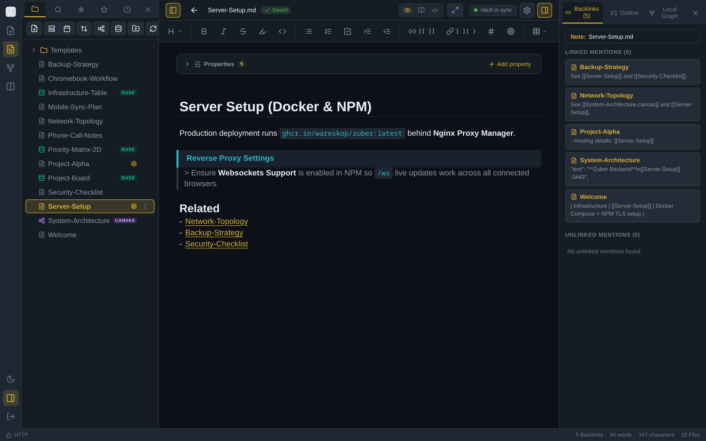
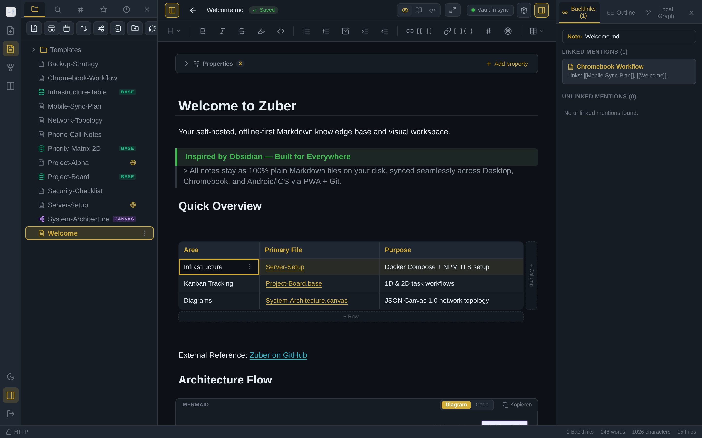
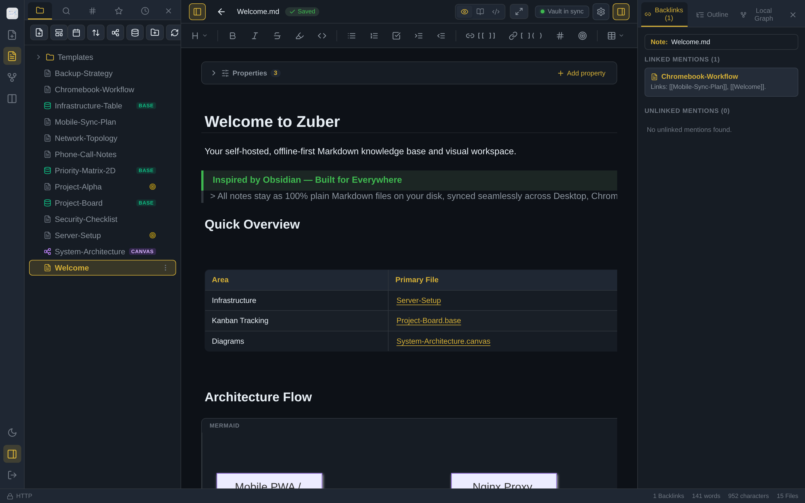
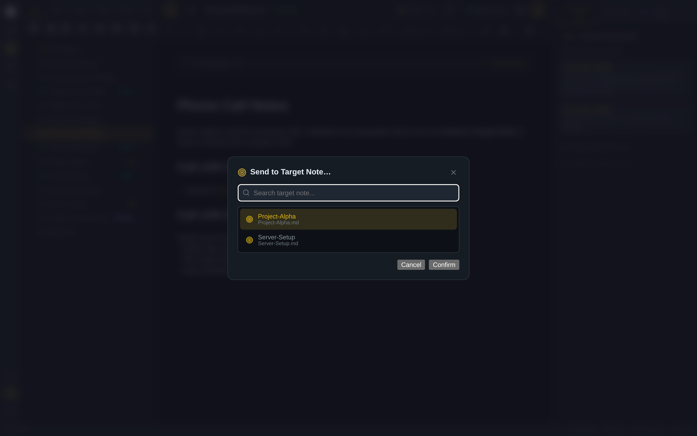
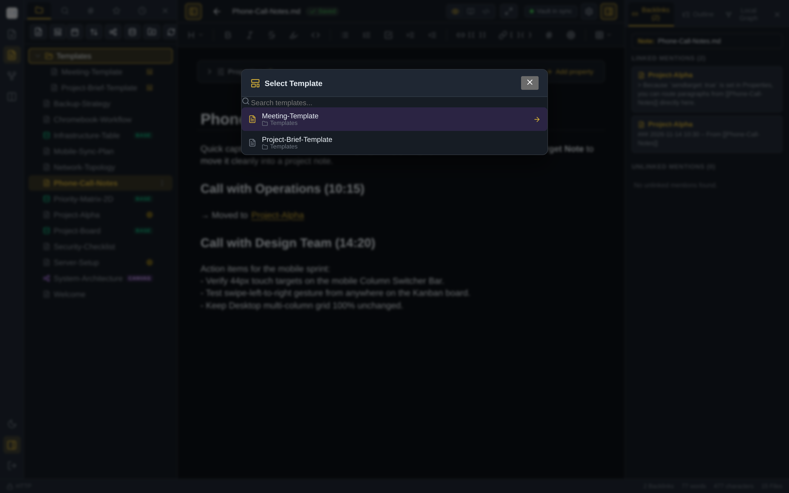

# 1. Markdown Editor & Workflows

Zuber's Markdown editor is powered by **CodeMirror 6** and designed around a single principle: **you should never have to stare at raw YAML or noisy formatting syntax while writing, yet your files remain 100% standard plain-text Markdown on disk.**

---

## 1. Three Editor Modes (`Live`, `Reading`, `Source`)

You can switch between three complementary views using the mode toggle in the top toolbar (or via the Command Palette `Ctrl+P`):

- **Live-Preview Mode (`live` — Desktop Default):** Renders headings (`#`–`######`), bold/italic/highlights (`==text==`), inline code, task checkboxes (`- [ ]` / `- [x]`), callouts, Markdown tables, Wiki-links (`[[Note]]`), tags (`#tag`), images, Mermaid diagrams, HTML previews, and embedded Bases/Canvases directly inline. Whenever your cursor enters a line, that line reveals its underlying Markdown syntax for effortless editing.
- **Reading Mode (`reading` — Mobile Default):** Renders the entire note as clean, read-only HTML sanitized with `DOMPurify`. Task checkboxes remain clickable, and Wiki-links, tags, Mermaid diagrams, and live Base/Canvas embeds are fully interactive.
- **Source Mode (`source`):** Displays the complete raw Markdown document, including the `---` YAML frontmatter header at the top, for power users who want direct raw-text control.



---

## 2. Visual Frontmatter Properties (`PropertiesEditor`)

In **Live-Preview** and **Reading** modes, YAML frontmatter is hidden from the document body and rendered as an interactive **Properties** panel above the note title:

- **Automatic Type Detection:** Zuber automatically maps keys to appropriate widgets:
  - `tags` / `tag` → Tag pill editor (`tags`)
  - `aliases` / `alias` → List chip editor (`list`)
  - `sendtarget` / `isTemplate` / booleans → Toggle checkbox (`checkbox`)
  - `YYYY-MM-DD` strings → Date picker (`date`)
  - Numbers → Numeric input (`number`)
  - Everything else → Text field (`text`)
- **Add or Remove Properties:** Click **+ Add Property** to attach new metadata fields without touching raw YAML syntax.

---

## 3. Rich Markdown Blocks: Callouts, Tables, Mermaid, HTML & PDFs

### Callouts
Use Obsidian-compatible callout syntax (`> [!NOTE]`, `> [!TIP]`, `> [!INFO]`, `> [!WARNING]`, `> [!CAUTION]`):

```markdown
> [!TIP] Live Embedded Dashboards
> You can embed any `.base` board or `.canvas` diagram inside a note using `![[Name.base]]` or `![[Diagram.canvas]]`.
```

### Interactive Visual Markdown Tables (In-Place Editing, `_tableWidths` & Sorting)
Standard GFM tables (`| Column | Column |`) render as interactive HTML tables in Live-Preview and Reading modes:
- **Stay Rendered on Click:** Clicking any header or body cell edits that cell directly in-place without collapsing back into raw pipe-delimited Markdown. (Switch to **Source Mode** anytime to edit raw pipes.)
- **Excel-Style Keyboard Navigation:**
  - `Enter` commits the current cell and moves focus to the cell **below** (automatically appending a new empty row at the bottom). `Shift+Enter` inserts `<br>` for multi-line content.
  - `Tab` / `Shift+Tab` moves horizontally across cells and appends a new row when pressed in the bottom-right cell.
  - `Escape` exits active cell editing cleanly.
- **Hover Quick-Add Bars & Context Menu:** Hovering the right or bottom edge reveals `+ Column` and `+ Row` bars; right-clicking any cell opens alignment (`Left`, `Center`, `Right`) and row/column insertion/deletion controls.
- **Hidden YAML Column Widths (`_tableWidths`):** Drag any column header divider to resize columns. Widths are persisted per table in YAML frontmatter under `_tableWidths` (keyed by header signature) and automatically hidden from the visual **Properties** panel.
- **Physical Column Sorting:** Click `↑` / `↓` in any header cell to sort rows physically in the underlying Markdown file using natural numeric, ISO-date, and alphabetical comparison.



### Mermaid Diagrams & Sandboxed HTML Blocks
Fenced code blocks marked with `mermaid` or `html` render live previews directly inside your note:
- **`mermaid`:** Renders flowcharts, sequence diagrams, ER diagrams, and state charts as crisp SVGs, with a `[ Diagram | Code ]` toggle in the block header.
- **`html`:** Renders inside a sandboxed `<iframe sandbox="allow-scripts">` with automatic height adjustment and a `[ Preview | Code ]` toggle.



### Inline PDF Viewer
Embed PDF attachments with `![[document.pdf]]` or specify a custom height with `![[document.pdf|700]]`. Zuber renders an inline PDF viewer with an "Open in new tab" button.

### Interactive Image Resize & Alignment Toolbar
Click any embedded image in Live-Preview mode to reveal corner resize handles and a floating alignment toolbar:
- **Resize:** Drag the handle to scale the image smoothly (persisted as standard ``).
- **Align:** Left, Center, Right, or Inline.
- **Remove from Note:** Click the trash icon in the floating image toolbar to remove the embed tag from the note without deleting the underlying attachment file from your vault.

### Quick Timestamp Shortcut
Press **`Ctrl+.`** (`Cmd+.` on macOS) anywhere in the editor—or run **Insert Timestamp** from the Command Palette—to insert the current local date and time (`YYYY-MM-DD HH:mm:ss`).

---

## 4. "Send to Target Note" Workflow (`sendtarget: true`)

When taking fast notes during a phone call or meeting, you often want to route a specific paragraph or action item straight into an existing project note without losing your place.

### Step 1: Mark Target Notes
Right-click any `.md` note in the File Tree and choose **Set as Send Target 🎯** (or add `sendtarget: true` to its frontmatter). Target notes display a subtle 🎯 badge in the File Tree.

### Step 2: Select & Send Text
1. Highlight any text block in your current note (for example, in `Phone-Call-Notes.md`).
2. Trigger **Send to Target Note…** via:
   - Right-click context menu in the editor,
   - The **Target** button in the editor formatting toolbar, or
   - The Command Palette (`Ctrl+P` → *Send selection to target note…*).
3. Pick the destination note in the searchable **Send to Target Note** modal (supports `↑`/`↓` and `Enter`).



### Step 3: Atomic Result
Zuber updates both notes in one atomic operation:
- **Origin note:** Replaces the selected block with `→ Moved to [[Target Note]]`.
- **Target note:** Appends a timestamped heading and backlink at the bottom:
  ```markdown
  ### 2026-11-14 10:30 – From [[Phone-Call-Notes]]

  <Moved paragraph or checklist>
  ```

---

## 5. Templates (`isTemplate: true`) & Daily Notes

### Creating & Using Templates
1. Create any Markdown note (for example, inside `Templates/`).
2. Right-click it in the File Tree and click **Set as Template** (or set `isTemplate: true` in Properties). Template notes show a template badge in the sidebar.
3. Click the **New from Template** icon in the File Sidebar header (or right-click any folder → **New note from template…**).



4. Choose a template and enter the new note's name. Zuber automatically:
   - Replaces `{{date}}` (`YYYY-MM-DD`), `{{time}}` (`HH:mm`), and `{{title}}` in both the note body and string frontmatter properties.
   - **Strips `isTemplate: true`** from the new note so instantiated notes never accidentally become templates themselves.

### Daily Notes (`Alt+D`)
Press **`Alt+D`** or click the Calendar icon in the File Sidebar to open today's Daily Note. Zuber uses a 10-character `YYYY-MM-DD` prefix search—so existing notes like `2026-11-14.md` or `2026-11-14 Daily Standup.md` are opened directly without creating duplicates. You can configure the target folder and template in **Settings → Editor & Files**.

---

## 6. Distraction-Free Zen Mode (`Alt+Z`)

Press **`Alt+Z`** to hide all sidebars, topbars, and surrounding chrome so you can focus exclusively on your writing. Press `Alt+Z` or `Esc` to return to the full workspace.

---

## 7. Client-Side PDF Export & Batch `.zip` Downloads

- **Export any Markdown note as PDF:** Click the **Export as PDF** icon in the editor toolbar/topbar, or right-click any `.md` note in the File Tree and choose **Export as PDF…**. Zuber switches cleanly to a light, ink-friendly print stylesheet (hiding sidebars, toolbars, and YAML frontmatter), converts embedded PDFs into attachment callout cards, and honors manual page breaks via `<!-- pagebreak -->`.
- **Download multiple selected items as `.zip`:** Select multiple files or folders using `Ctrl+Click` / `Shift+Click` in the File Tree, right-click, and click **Download Selection (.zip) (N)**.
