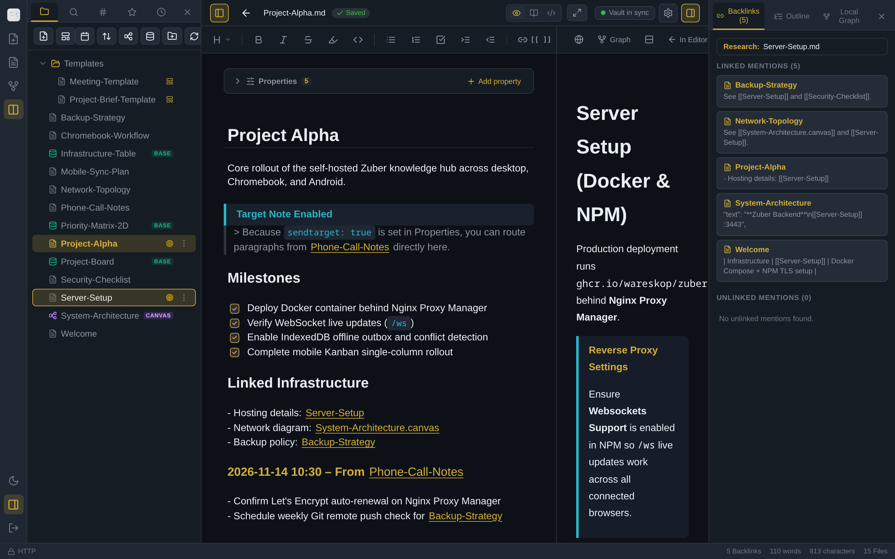
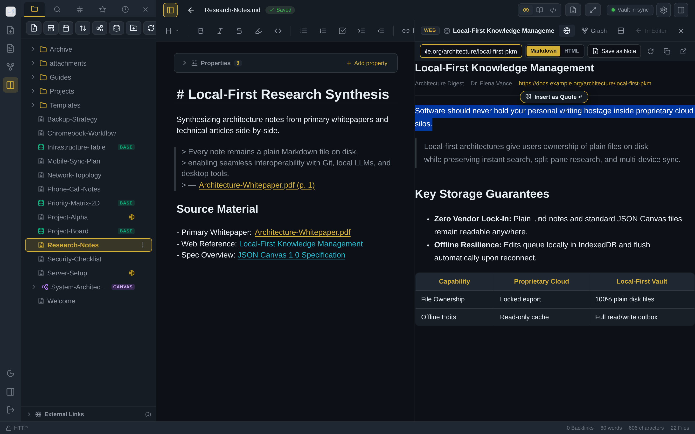
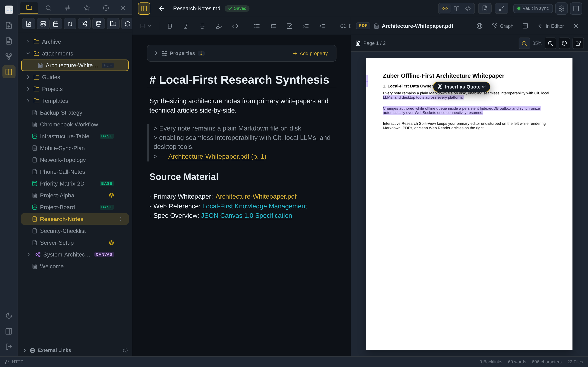
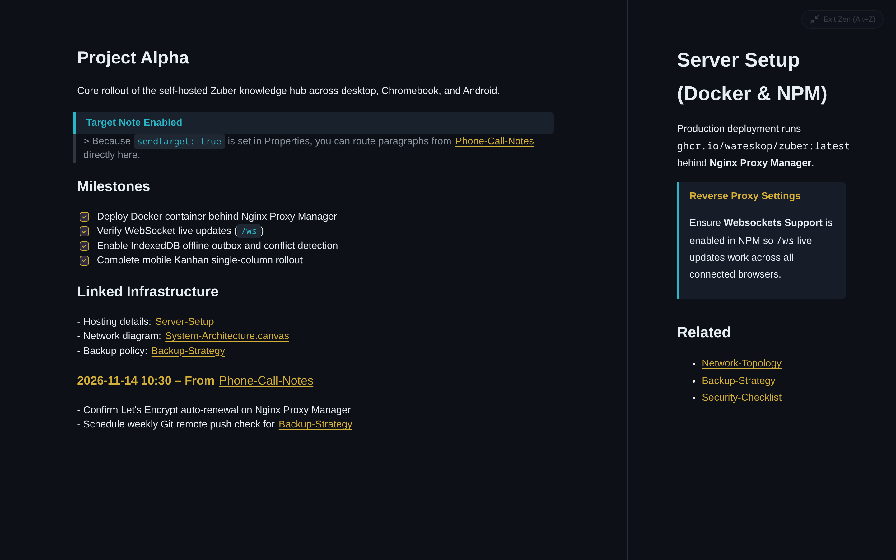

# 2. Research Split-View

When writing technical documentation, synthesizing meeting notes, or comparing diagrams, constantly switching tabs breaks your concentration. Zuber's **Research Split-View** lets you keep your active note locked on the left while browsing reference material on the right.

---

## 1. Asymmetric 70/30 Split Concept

- **Left — Primary Editor (70% default):** Full interactive editing focus (`LivePreviewEditor`, `CanvasEditor`, or `BaseEditor`). Your cursor position, scroll state, and active document remain undisturbed.
- **Right — Research Pane (30% default):** Strictly **Read-Only** reference viewer. You can inspect notes, diagrams, and PDFs without accidentally modifying them.
- **Draggable Resizer:** Drag the vertical splitter bar between the two panes to adjust the split ratio anywhere between **20% and 80%** (persisted in `localStorage` under `zuber_split_ratio`).

---

## 2. Smart Click-Routing & `Alt+Click` Override

When the Research Split-View is **open**:

| Action | Destination |
| :--- | :--- |
| **Normal Click** on a file in the File Tree, a `[[Wiki-Link]]`, or a Backlink | Opens in the **Right Research Pane** (Primary Editor stays untouched) |
| **`Alt + Click`** on a file in the File Tree, a `[[Wiki-Link]]`, or a Backlink | Opens in the **Left Primary Editor** |
| **Open in Main Editor** button (`←`) in the Research Pane header | Moves the currently viewed reference document into the Left Primary Editor |

> [!TIP]
> Right-clicking any file in the File Tree also offers explicit **Open in Research View** and **Open in Main Editor (Alt+Click)** menu actions.

---

## 3. Supported Reference Formats

The Research Pane renders all major vault and web formats natively:
1. **Markdown Notes (`.md`):** Full Reading Mode rendering (Callouts, styled Blockquotes with preserved multi-line breaks, Task lists, Tables, Mermaid diagrams, Inline Images, PDF embeds).
2. **Canvas Diagrams (`.canvas`):** Interactive read-only pan and zoom viewer powered by `@xyflow/react`.
3. **Bases (`.base`):** Interactive read-only database view.
4. **Images (`.png`, `.jpg`, `.jpeg`, `.gif`, `.webp`, `.svg`):** Centered viewer with Zoom In / Zoom Out / Fit controls.
5. **PDF Documents (`.pdf`) via Offline Text-Layer Viewer:** Rendered locally with bundled `pdfjs-dist` (zero external CDN requests — works offline for both Vault PDFs and proxied Web PDFs). Displays HiDPI `<canvas>` pages with a transparent selectable `.textLayer`, live page indicator (`Page N / M`), zoom controls (`-`, `+`, Reset `115%`), and an external open button.
6. **Knowledge Graph (`graph`):** Toggle directly to the interactive Knowledge Graph inside the Research Pane header.
7. **Ad-Free Web Reader & Browser (`http://` / `https://`):**
   - When Research Split-View is **open**, clicking an external `http://` or `https://` link inside any note or the Global External Links sidebar loads it inside the right Research Pane instead of leaving Zuber (use **`Ctrl+Click` / `Cmd+Click` / Middle-Click** to open directly in an external browser tab).
   - **`[ Markdown | HTML ]` Segmented Toggle:** Defaults to **Markdown**, which fetches the target via Zuber's SSRF-hardened backend extractor (`@mozilla/readability` + `turndown` + GFM tables/checklists, resolving relative image `src` and link `href` paths against the final URL) and renders the ad-free article in clean typography. Switch to **HTML** anytime to inspect the live page inside a sandboxed `<iframe>` (with an automatic **Embed-Blocked Fallback Card** if the site sets `X-Frame-Options` or CSP `frame-ancestors`). Web PDFs are automatically detected and handed off to the offline PDF Text-Layer Viewer via `/api/web/proxy-pdf`.
   - **Save as Note:** Click **Save as Note** in the Web Reader toolbar to clip the entire extracted Markdown article into your vault with automatic YAML metadata (`source`, `clipped`, and optional `site` / `author`).

---

## 4. Offline PDF Text-Layer & Drag-and-Drop Blockquote Citations

Zuber turns the Research Split-View into a friction-free literature synthesis workspace:

- **Highlight & Click `Insert as Quote ↵`:** Select any text inside a Web Reader article, an offline PDF page, or a Research Reading-Mode note to surface the floating **Insert as Quote ↵** popover right above your selection. Clicking it inserts the formatted blockquote straight into your active editor note.
- **Direct Drag & Drop onto Exact Line:** Drag any selected passage from the Web Reader, PDF Text-Layer, or Research Reading View and drop it directly onto the target line in the left **Live-Preview Editor** (`view.posAtCoords` places it precisely at the drop cursor).
- **Automatic Page & Source Attribution:** Dropped or inserted quotes preserve multi-line Markdown line breaks (`> ...`) and automatically append a clean citation footer — including exact page numbers for PDF quotes (for example, `> — [Architecture-Whitepaper.pdf (p. 1)](attachments/Architecture-Whitepaper.pdf)` or `> — [Article Title](https://...)`).

---

## 5. Automatic Back-Button & Right-Sidebar Sync

Zuber keeps navigation and context coherent while Research Split-View is active:

- **Topbar Back-Button (`←` / `Alt+←`):** Maintains a dedicated `researchHistory` stack. Clicking Back (or pressing `Alt+ArrowLeft`) navigates backward through the documents you opened in the **Right Research Pane**. Holding **`Alt + Click`** on the Back button steps back in the **Left Primary Editor** instead.
- **Right-Sidebar Mentions & Local Graph Sync:** When the Research Pane is open, the Right Sidebar automatically tracks the **active reference document** (indicated by a target badge at the top of the Backlinks panel) so you can explore linked/unlinked mentions and local graph connections for what you are researching. Closing the Research Pane immediately switches the Right Sidebar back to your Primary Editor note.

---

## 6. Zen Split-View (`Alt+Z`) & Mobile Vertical Split

- **Zen Mode (`Alt+Z`):** Enabling Zen Mode while Research Split-View is open hides the topbar, sidebars, and toolbars while **preserving both split panes** and keeping the 1px center divider draggable.
- **Mobile Vertical Split (`< 768px`):** On smartphones, Research Split-View automatically switches from a horizontal side-by-side layout to a **vertical top/bottom split** (reference pane on top, editor on bottom) so the on-screen keyboard never obscures your reference material. You can also toggle Columns ⇄ Rows manually using the orientation button in the Research Pane header.

