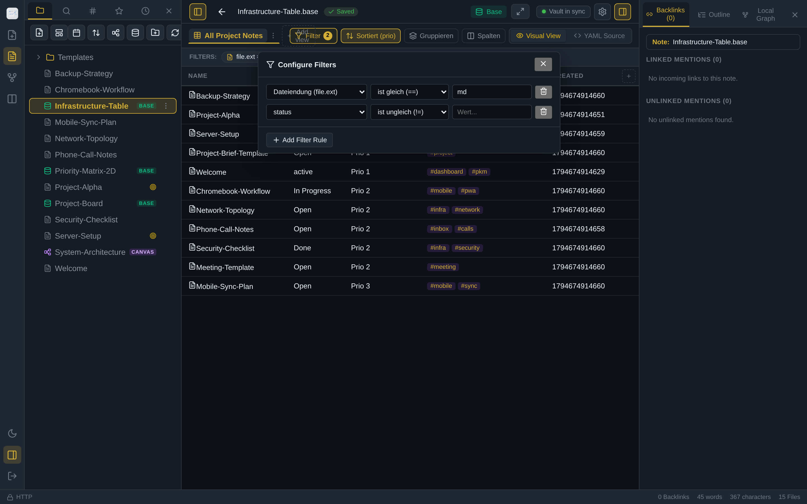
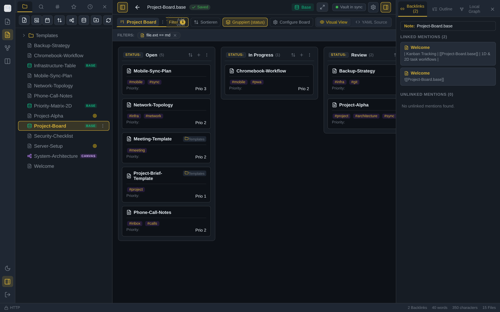
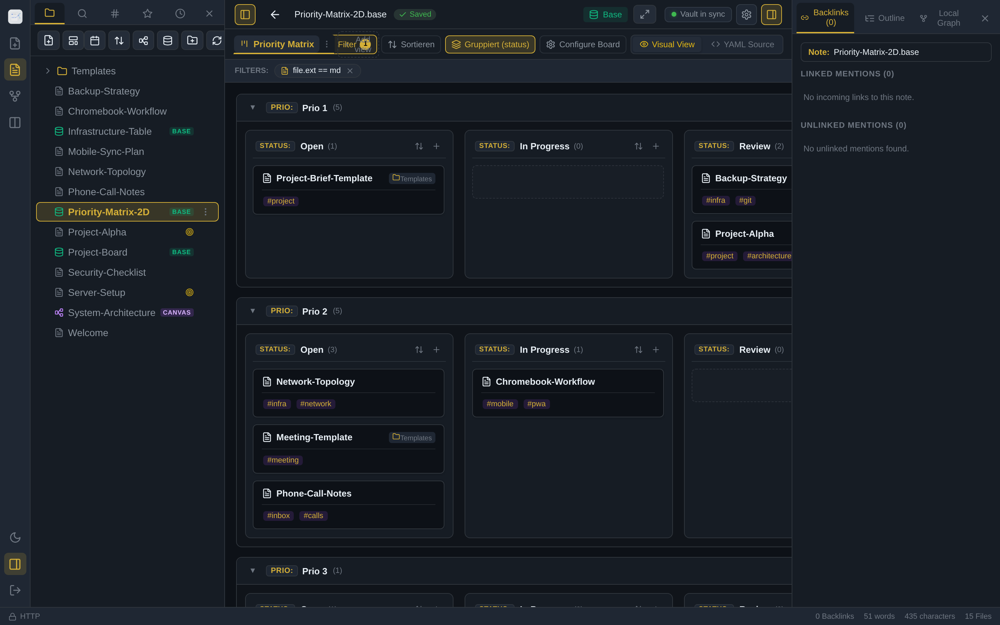
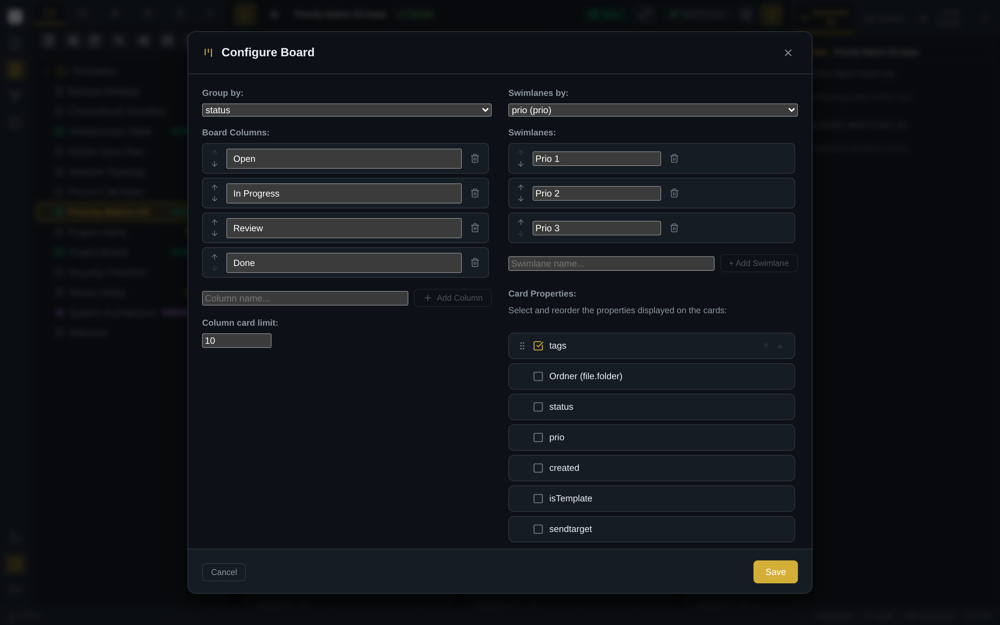

# 3. Bases, Dashboards & Kanban

Zuber includes native support for **Obsidian Bases (`.base`)**—turning folders, tags, and YAML frontmatter properties across your Markdown notes into live **Tables**, **Card Grids**, **1D Kanban Boards**, and **2D Swimlane Matrices**.

---

## 1. Creating a `.base` Database

Click the **New Base** icon (`Database`) in the File Sidebar header, right-click any folder → **New Base**, or run **Vault: Create New Base** from the Command Palette (`Ctrl+P`).

A `.base` file is plain-text YAML stored in your vault:

```yaml
filters:
  and:
    - file.ext == "md"
    - file.inFolder("Projects")
views:
  - type: board
    name: "Project Board"
    groupBy:
      property: status
      columns:
        - Open
        - In Progress
        - Review
        - Done
    columnLimit: 10
    order:
      - file.name
      - tags
      - prio
```

You can switch between the **Visual View** and **YAML Source** at any time using the `[ View | Source ]` toggle in the Base Toolbar.

---

## 2. Table & Card Views with Visual Filters

- **Table View (`type: table`):** Resize columns by dragging column borders, reorder columns via drag & drop, click column headers to sort, and **edit frontmatter properties inline** (text, numbers, checkboxes) with automatic write-back to the underlying `.md` note.
- **Cards View (`type: cards`):** Displays notes as responsive cards with configurable properties, folder pills, and tags.
- **Visual Filter Builder:** Click **Filter** in the Base Toolbar to add rules using `file.inFolder`, `file.hasTag`, `file.hasLink`, `file.name`, `file.ext`, or any frontmatter property (`==`, `!=`, `contains`, `startsWith`, `>`, `<`, `isEmpty`, `!isEmpty`). Active rules appear as dismissible **Filter Chips** below the toolbar.



---

## 3. 1D Kanban Boards

Switch a view to `type: board` (or create a Board view via **+ View**) to group notes into columns by any frontmatter property (default: `status`):

- **Zero-Latency Drag & Drop:** Dragging a card to another column updates the UI immediately and persists the new property value to the note's YAML frontmatter via `api.saveNote()`.
- **Add Card (`+`):** Clicking `+` in any column header opens the **New Note** dialog with the target folder (derived from active `file.inFolder` filters) and column property pre-filled.
- **Per-Column Sorting (`⇅`):** Sort individual columns by Name (`file.name`), Creation Date (`file.ctime`), or any visible card property (`A–Z` / `Z–A`), persisted per column in YAML.
- **Pagination (`columnLimit`):** Long columns show the top N cards (default `10`) with a **Show more / Show fewer** toggle.



---

## 4. 2D Kanban Boards with Swimlanes

For multi-dimensional workflows (such as tracking **Status × Priority**), enable **Swimlanes** in **Configure Board**:

- **Unified Column Blocks:** Each swimlane row renders a collapsible header (`▼` / `▶`, persisted in YAML) and a row of column cells (`STATUS: Open`, `STATUS: In Progress`, etc.). Notes without a swimlane value automatically appear in an **Unassigned** catch-all lane.
- **Dual-Property Drag & Drop:** Dropping a card into a `(Column × Swimlane)` cell updates **both** frontmatter properties atomically in a single save.
- **Contextual `+` Creation:** Clicking `+` inside a swimlane cell pre-fills both the column property and the swimlane property on the newly created note.



---

## 5. Configuring Columns, Swimlanes & Card Properties

Click the **Board** settings button (`⚙`) in the Base Toolbar to open the two-column **Configure Board** modal:

- **Left Column:** Choose the `Group by` property, add/rename/reorder/delete columns, and set the per-column card limit.
- **Right Column:** Select a `Swimlanes by` property (auto-suggesting existing vault values), manage swimlane order, and check/reorder which **Card Properties** (`tags`, `prio`, `file.folder`, deadlines, etc.) appear on each card.



---

## 6. Embedding Live Dashboards (`![[Name.base]]`)

Embed any `.base` file directly inside a Markdown note:

```markdown
![[Project-Board.base]]
![[Project-Board.base#Priority Matrix]]
```

Embedded Bases are interactive in both **Live-Preview** and **Reading** modes, complete with view switcher pills and clickable cards. You can also write inline ```` ```base ```` YAML code blocks inside any Markdown note.
