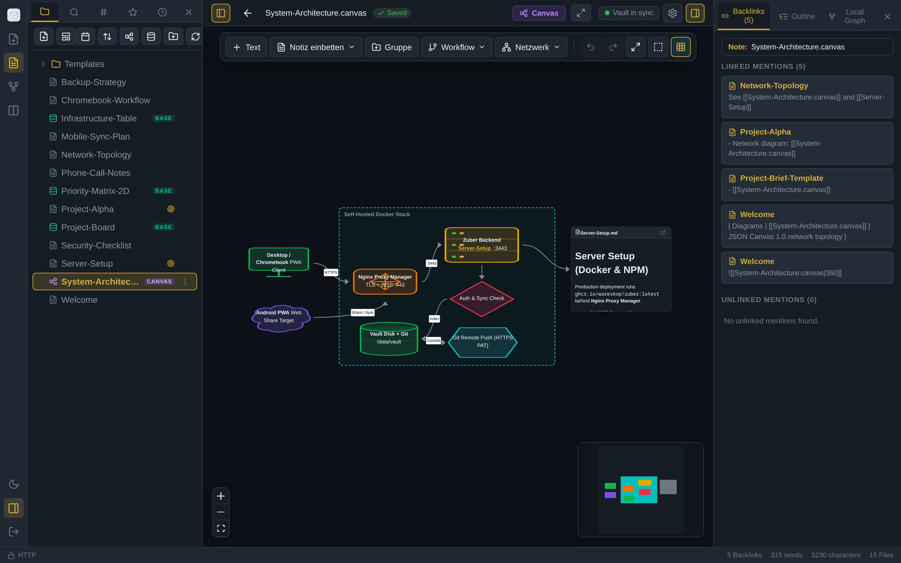
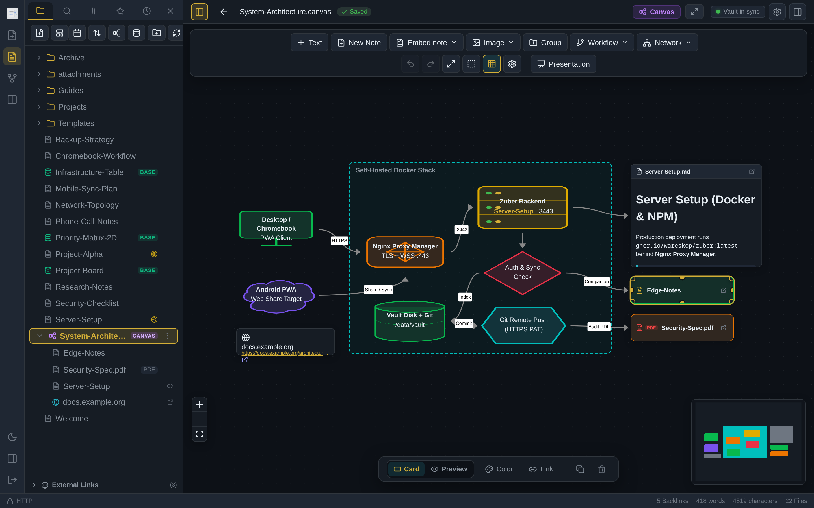
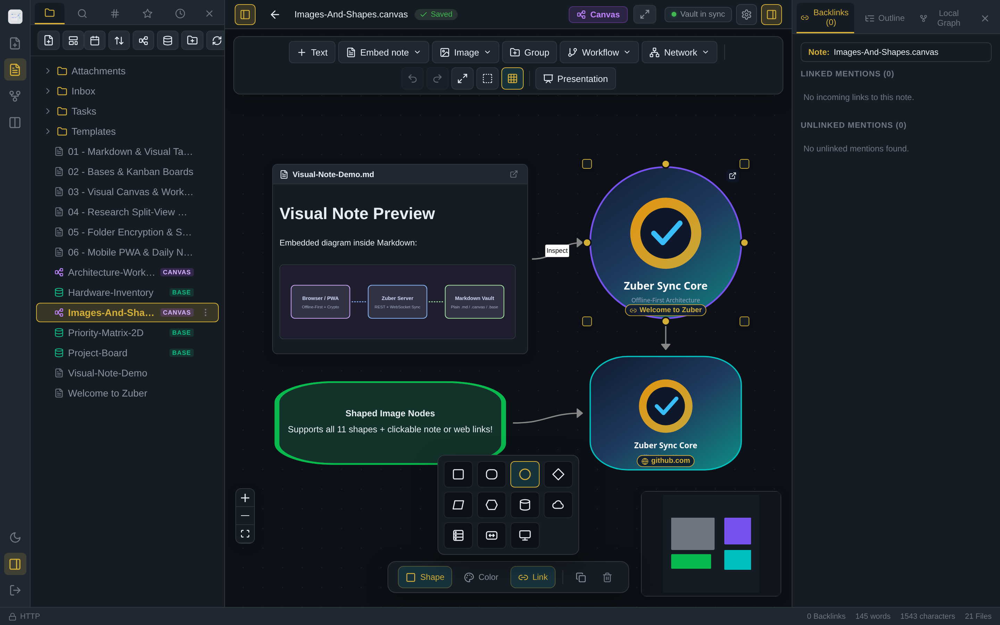
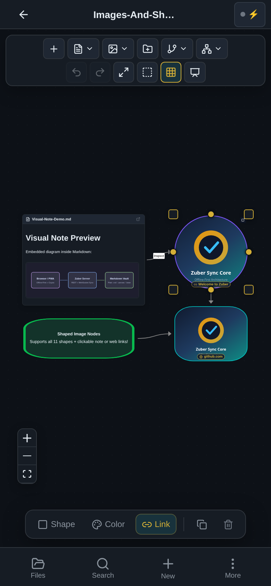
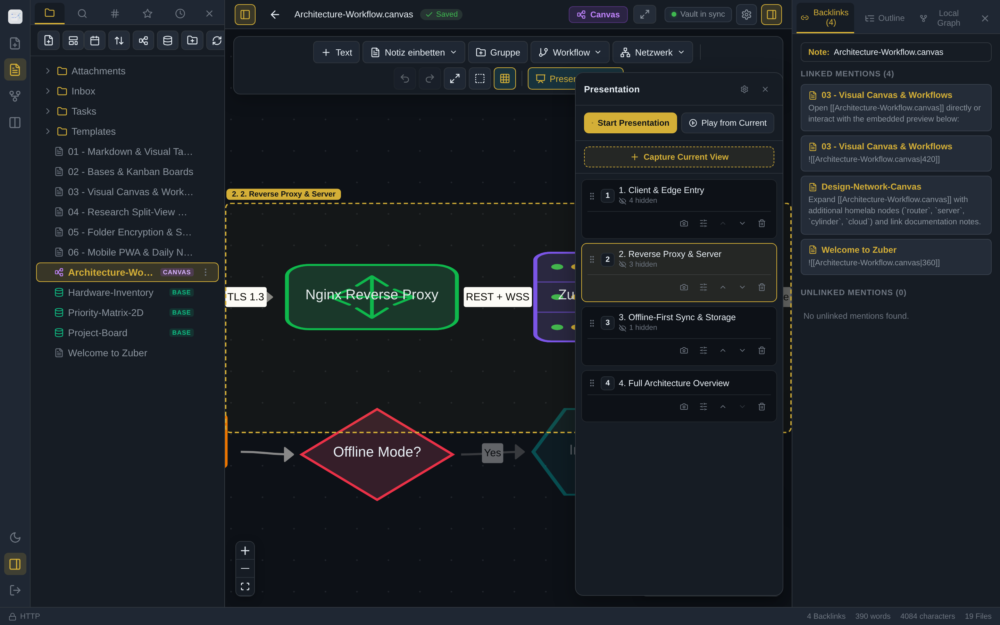
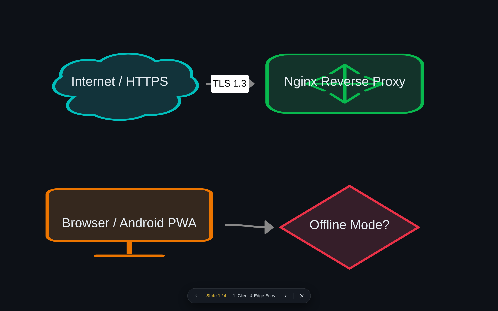

# 4. Canvas & Visual Diagrams

Zuber features a built-in visual **Canvas, Workflow & Network Diagram Editor** for `.canvas` files, built on `@xyflow/react` and **100% compatible with the official Obsidian JSON Canvas 1.0 specification**.

---

## 1. JSON Canvas 1.0 + Extended Shapes

Every `.canvas` file is saved as clean, standard JSON (without YAML frontmatter). Alongside standard Obsidian cards, groups, and web links, Zuber supports **11 geometric, workflow, and network shapes** with graceful degradation if opened in Obsidian Desktop:

| Category | Shapes |
| :--- | :--- |
| **General / Workflow** | `rectangle`, `rounded`, `circle`, `diamond` (Decision), `parallelogram` (I/O), `hexagon` (Filter/Prep) |
| **System / Network** | `cylinder` (Database), `cloud` (Internet/Cloud), `server` (Server/VM), `router` (Router/Firewall), `workstation` (Client) |



---

## 2. Creating Nodes, Images, Groups & Connections

Use the top floating **Canvas Toolbar** (automatically collapsing button labels on viewports `<= 900px` for maximum smartphone space) to add elements:
- **+ Text:** Add a Markdown text/shape node. Double-click any shape (or select it and start typing directly — *Type-to-Edit*) to edit its Markdown content, including inline `![[image]]` embeds.
- **+ New Note:** Click **+ New Note** in the toolbar—or right-click empty canvas space → **Create New Note…**—to open an inline prompt and create a fresh `.md` note directly on the canvas. The new file is automatically saved inside the canvas's companion folder without manual path typing.
- **+ File / Embed Note:** Search and embed any `.md`, `.pdf`, or vault file as a `CanvasFileNode` with quick open (`↗`), node color tinting, and optional live preview.
- **Compact Card vs. Preview Mode (`displayMode`) with Remembered Size:** Newly added `.md` and `.pdf` file nodes start as sleek, single-row **Compact Cards** (`220×58`, icon + clean title + `↗` open button, no scrollbars). Click `[ Card | Preview ]` in the **Canvas Inspector** (or the quick toggle on the node) to expand any `.md` or `.pdf` node into a scrollable **Markdown Reading Preview** (complete with images, callouts, `.zenc` decryption, and cycle-safe nested `.canvas` embeds) or an embedded **PDF Preview**. Whenever you resize a node in **Preview** mode and switch back to **Card**, Zuber remembers your custom `previewWidth` and `previewHeight`—staying 100% backward-compatible with JSON Canvas 1.0.
- **Image ⌄:** Upload an image directly from your device or choose any existing vault image (`.png`, `.jpg`, `.jpeg`, `.gif`, `.webp`, `.svg`, `.avif`, including `.zenc`).
- **Multi-Source Drag & Drop & Paste (`Ctrl+V`):** Drag existing `.md`, `.pdf`, or image files straight from the left **File Tree** (`FileSidebar`), drop `.pdf` or image files directly from your OS file manager (auto-saved into the canvas companion folder), or paste clipboard images onto the canvas.
- **Group:** Create a labeled visual container. Dragging a group automatically moves all enclosed child nodes together.
- **Workflow ⌄ / Network ⌄:** Drop pre-styled workflow or infrastructure shapes onto the canvas.
- **Box Select (`Marquee`):** Toggle drag-box selection (or hold `Shift` + drag) to select, move, duplicate, or delete multiple nodes at once.
- **Grid & Snap & Canvas Settings (`⚙`):** Configure grid visibility (`Dots`, `Lines`, `Off`), snap size (`10px`, `15px`, `20px`, `25px`), and customize the canvas's **Assets Folder (`assetsFolder`)** override.

### Companion Folder (`<CanvasName>.canvas.assets/`) & Virtual Sidebar Tree
When you create a new note or drop an external image/PDF onto a canvas (for example, `Projects/System-Architecture.canvas`), Zuber lazily creates its companion directory `System-Architecture.canvas.assets/` right alongside it (unless overridden via `assetsFolder` in Canvas Settings):
- **Decluttered Sidebar:** Raw `.canvas.assets/` folders are hidden as standalone directories in the left **File Tree**.
- **Expandable Canvas Row (`▸` / `▾`):** Every `.canvas` file with companion assets, referenced vault notes, or external URLs displays an expand chevron revealing:
  1. Physical companion notes, PDFs, and images inside `<Canvas>.canvas.assets/`,
  2. Linked vault files residing in other folders (marked with a link badge), and
  3. External `http(s)://` URLs referenced by canvas link or text nodes (globe icon).
- **Atomic Rename & Move Sync:** Renaming or moving `System-Architecture.canvas` in the File Tree automatically moves `System-Architecture.canvas.assets/` along with it and updates every internal node and link across the vault.



### Image Shapes & Clickable Links
- **All 11 Shapes for Images:** Select any image node and pick any of the 11 shapes (`circle`, `rounded`, `diamond`, `hexagon`, `cloud`, etc.) from the compact **4-column icon Shape Picker** (hover over any symbol to view its localized name). Images clip cleanly inside the shape border.
- **Attach Clickable Links:** Open **Link** in the Inspector on any image or file node to attach either an **internal vault note/file** or an **external web URL** (`https://...`). A clickable link badge appears on the card (`Ctrl/Cmd+Click` or double-click in Edit Mode; single-click in Read-Only / Presentation Mode).



### Smart Edge Drawing & Enlarged Touch/Mouse Handles
- Hover over (or tap on touch devices) any node to reveal its 4 centered connection handles (`top`, `right`, `bottom`, `left`) with enlarged `14×14px` desktop / `22×22px` touch visual dots and wide invisible hit areas (`34×34px` desktop, `46×46px` touch).
- Drag from a handle to another node to create a directed arrow edge.
- **Drop onto Empty Canvas:** Dragging a connection handle onto empty space automatically creates a new connected node at the drop location, docked to the nearest side!
- **Reconnect Edges:** Select any edge (highlighted in gold) and drag its endpoints to attach it to a different node.



---

## 3. Wiki-Links Inside Canvases & Vault Integration

Canvases are first-class citizens in Zuber's vault index:
- Typing `[[` inside any shape or edge label opens **Wiki-Link Autocomplete**.
- Embedded note cards (`type: file`) and `[[Wiki-Links]]` inside shapes or edge labels automatically appear in the **Knowledge Graph** and **Backlinks** panel.
- Renaming or moving a note in the File Tree automatically updates all references inside `.canvas` files.

---

## 4. Right-Click Context Inspector & Floating Toolbar

- **Left-clicking** a node or edge displays the floating **Canvas Inspector** at the bottom of the screen to change colors, shapes, edge routing (`Bezier`, `Straight`, `Step`), labels, or duplicate/delete items.
- **Right-clicking** any node or edge opens the Inspector directly at your cursor position for fast adjustments.

---

## 5. Embedding Canvases in Markdown Notes (Cycle-Safe)

Include live, interactive pan-and-zoom diagrams inside any Markdown note:

```markdown
![[System-Architecture.canvas]]
![[System-Architecture.canvas|420]]
```

Clicking the diagram title in the embed header opens the full `.canvas` file in the Canvas Editor. Embedded `.md` notes inside a canvas also render non-circular nested `.canvas` embeds live, while automatically detecting and blocking circular references (e.g., if Note A embeds Canvas B while Note A is itself displayed inside Canvas B).

---

## 6. Canvas Presentation Mode (Slides, Camera Path & Progressive Reveal)

Turn any `.canvas` diagram into a smooth, resolution-independent presentation stored directly inside the `.canvas` JSON (`"presentation"` key, 100% compatible with Obsidian JSON Canvas 1.0):

- **Resolution-Independent Slides:** Click **Presentation** in the Canvas Toolbar to open the Presentation Panel, then pan/zoom to any region and click **+ Capture Current View**. Slides store world-space `bounds` (`x`, `y`, `width`, `height`), guaranteeing identical framing on 1080p, 4K, ultrawide, and tablet screens.
- **Per-Slide Element Visibility & Ghosting:** When a slide is selected in the panel, you can hide nodes for that slide via the **Canvas Inspector** (`EyeOff`) or click the `EyeOff` badge on ghosted nodes (`opacity: 0.35`) to reveal them again. Deleted nodes are automatically pruned from `hiddenNodeIds`.
- **Configurable Camera & Reveal Timing:** Expand the **Settings (`⚙`)** section to adjust global **Camera Speed** (`200–2500 ms`), **Camera Arc** (`None`, `Subtle`, `Medium`, `Strong` parabolic zoom-out between distant slides), **Element Reveal Speed**, **Reveal Delay**, and **Stagger Delay**, or override timing per slide.



- **Fullscreen Playback & Controls:** Click **Start Presentation** or **Play from Current** to enter a distraction-free fullscreen stage.
  - `Space`, `ArrowRight`, `PageDown`, or `Enter`: Advance to the next slide (or fast-forward a running transition/reveal). Edges appear automatically once both connected nodes are visible.
  - `ArrowLeft` or `PageUp`: Step back cleanly to the previous slide.
  - `Escape`: Exit presentation mode.
  - A minimal bottom-center **Floating HUD** auto-fades when the mouse is idle.


