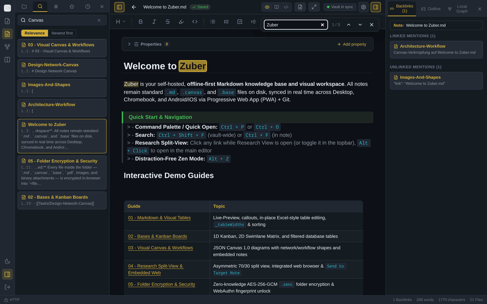
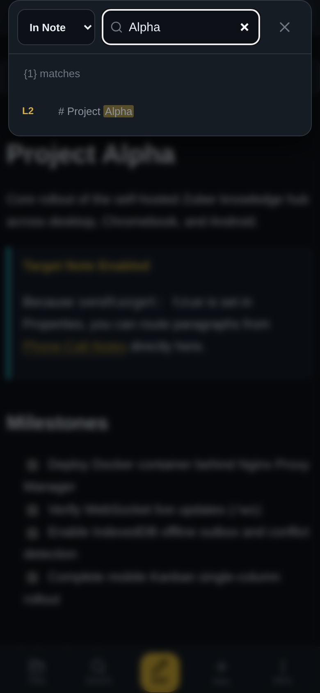
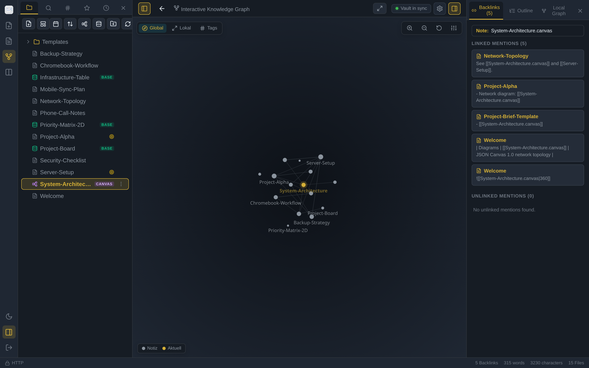

# 5. Navigation, Graph & Search

Zuber is built for vaults with thousands of interconnected notes, diagrams, and attachments. Its navigation, search, and graph tools are powered by the server's in-memory index (`VaultService`) and mirrored in IndexedDB for instant offline access.

---

## 1. File Tree, Multi-Select & Drag-and-Drop

The **Left Sidebar** (`Ctrl+\`) provides a hierarchical file explorer with dedicated badges for `.base` (`BASE`), `.canvas` (workflow icon), Templates, and Send Targets (🎯):

- **Sorting (`⇅`):** Sort the tree by Name (`A–Z` / `Z–A`) or Modification Date (`Newest first` / `Oldest first`). Folders always stay grouped at the top, and date sorting recursively evaluates the newest file inside each folder.
- **Multi-Select:**
  - `Ctrl+Click` / `Cmd+Click` toggles individual files or folders.
  - `Shift+Click` selects a contiguous range across the visible tree.
- **Drag & Drop & "Move to…":**
  - Drag single or multi-selected items onto any folder in the tree (hovering over a collapsed folder for `500ms` auto-expands it).
  - Or right-click → **Move to…** to open a keyboard-searchable folder picker (`MoveToModal`), preventing circular folder moves.
  - **Drag into Editor:** Dragging a note, image, PDF, or canvas from the File Tree into the Markdown editor automatically inserts a `[[Wiki-Link]]` or `![[Embed]]` at the drop position.
  - **External File Drop & Download:** Drop files or folders from your OS file manager straight onto the File Tree to upload them, or right-click any file/folder → **Download** (folders stream as `.zip` archives).

---

## 2. Vault-Wide Automatic Link Refactoring

Whenever you **rename** or **move** a note, canvas, attachment, or entire folder, Zuber automatically updates every reference across your entire vault:
- `[[Wiki-Links]]` (preserving `#headings`, `^blocks`, and `|aliases`)
- `![[Wiki-Embeds]]` (preserving `|width` / `|height` sizes)
- Standard Markdown links `[Text](path)` and images ``
- Inline HTML `` tags
- `.canvas` file node references (`node.file`), text nodes, and edge labels
- `.base` path/folder filters (`file.inFolder(...)`)

---

## 3. Latching Favorites & Recent Notes Panels

Next to the **Files**, **Search**, and **Tags** tabs in the left sidebar are two latching toggle buttons:
- **Favorites (`★`):** Pins a persistent Favorites panel above the file tree. Right-click any file or folder → **Add to Favorites** / **Remove from Favorites**.
- **Recent Notes (`🕒`):** Displays the last 10 opened notes and canvases for one-click context switching.
- Both panels stay synchronized automatically when files are renamed or deleted.

---

## 4. Unified 4-Mode Search, In-Note Jump Bar & Command Palette

Zuber uses a unified whole-word search engine (`shared/searchEngine.ts`) across Desktop, Mobile, and Offline IndexedDB cache:

- **Unified Search (`Ctrl+Shift+F` / Mobile Search):** Search across `Full Text`, `In Note`, `Files`, and `Commands` with:
  - **Whole-Word Default** (`\b...\b`), `*` wildcards (`docker*`), `+required` / `-excluded` terms, and `"exact phrases"`.
  - Toggleable **`?` Syntax Help** banner and **Relevance | Newest** result sorting.
- **Floating In-Note Jump Bar (`Ctrl+F` / `Cmd+F`):** Opens an inline match counter (`N / M`) with `▲` / `▼` (`Enter`/`F3`, `Shift+Enter`/`Shift+F3`) navigation in both Live-Preview and Reading Mode.
- **Quick Switcher (`Ctrl+O` / `Cmd+O`):** Fuzzy-search across note titles, paths, and aliases to jump immediately with `Enter`.
- **Command Palette (`Ctrl+P` / `Cmd+P`):** Instant access to every Zuber command—creating notes, bases, canvases, switching themes, toggling Zen Mode, inserting timestamps, opening Version History, and triggering Git commits.
- **Mobile 4-in-1 Search Modal (`< 768px`):** Tapping **Search** in the mobile bottom bar opens the same unified modal tuned for touch (`In Note` default with match jump bar, `Files`, offline `Full Text`, and `Settings` tab shortcuts).

---

## 5. Interactive 2D Knowledge Graph

Zuber renders a force-directed **2D Knowledge Graph** (`GraphView`) in three places:
1. **Global Graph:** Full-vault network view accessible from the topbar/Command Palette.
2. **Local Graph:** Neighborhood view in the Right Sidebar showing direct connections of the active note (or active Research Pane document).
3. **Graph Split / Research Graph:** Side-by-side next to your editor.

### Graph Controls & Physics
- **Node Types & Theme Colors:** Distinguishes Markdown notes, `.canvas` diagrams, attachments, tags, and unresolved `[[links]]` using your active theme's accent palette.
- **Filter & Search:** Filter by `#tag`, folder, or search query, and toggle orphan or unresolved nodes.
- **Cooling Physics Simulation:** Nodes settle smoothly using an `alpha` cooling factor and drop to **0% CPU usage** once settled, waking automatically when you drag a node, pan, or zoom.
