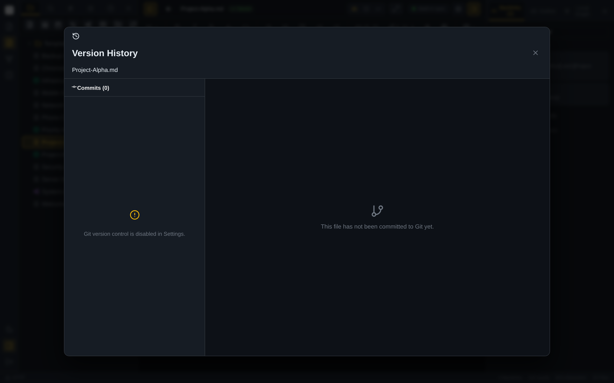

# 6. Git Versioning & History

Your notes are your long-term memory. Zuber ships with a **built-in, containerized Git engine** (`GitService`) so every edit is versioned automatically and can be backed up to any remote Git host—without requiring Git to be installed or configured manually on your host OS.

---

## 1. Containerized Git Runtime & Auto-Commits

- **Zero Host Dependencies:** The official Zuber Docker image bundles `git` out of the box and executes all repository operations directly inside `VAULT_DIR` (`/data/vault`).
- **Watcher Loop Protection:** Zuber's filesystem watcher (`chokidar`) strictly ignores `.git/` so commits never trigger false reload loops.
- **Exclusive Operation Queue (`runExclusive`):** All Git commands are serialized through an internal promise queue to prevent `.git/index.lock` collisions during concurrent edits.

### Automatic Commit Triggers
- **On Note Leave / Switch:** Whenever you switch away from a modified note, Zuber creates an automatic commit (`auto: update <path>`).
- **On Session Close:** When all active browser/WebSocket connections disconnect (for example, when you close your last tab), Zuber waits for a 5-second debounce, commits any remaining changes (`auto: session closed`), and—if configured—pushes to your remote repository.
- **Manual Commit:** Trigger an immediate commit anytime via **Settings → Git Backup** or the Command Palette.

---

## 2. Remote HTTPS Backup (GitHub, Codeberg, GitLab)

Configure encrypted off-site backups under **Settings → Git Backup**:
1. Enable **Git Versioning** and set your Git Author Name and Email.
2. Enable **Remote Backup** and enter your HTTPS repository URL (e.g., `https://github.com/username/my-vault.git`), branch (`main`), username, and a **Personal Access Token (PAT)**.
3. Click **Test Connection** to verify access via `git ls-remote`, then **Save** or **Push Now**.

> [!NOTE]
> **Credential Security:** Zuber never writes your Personal Access Token into `.git/config` on disk. Authenticated remote URLs are constructed ephemerally in memory only for the duration of a push, masked in API responses (`hasToken: true`), and scrubbed from all logs and error messages.

---

## 3. Per-File Version History (`git log --follow`)

To inspect the full history of any `.md` note or `.canvas` board:
- **Right-click** the file in the File Tree → **Version History**, or
- Open the **Command Palette (`Ctrl+P`)** → **Vault: Open Version History for Current Note**.

Zuber runs `git log --follow`, so **a file's complete history is preserved even across renames and folder moves**.

---

## 4. Visual Diff Viewer & One-Click Restore

The **Version History** modal displays the commit timeline on the left and a syntax-aware viewer on the right with three modes:
1. **Diff vs. Current (`diff-current`, Default):** Highlights every line added (`+` in green) or removed (`-` in red) compared to your live working file.
2. **Diff vs. Previous Commit (`diff-previous`):** Shows exactly what changed in that specific commit relative to its parent.
3. **Full Content (`full`):** Displays the complete file snapshot from that commit with line numbers.

### One-Click Restoration
Click **Restore This Version** and confirm the inline prompt. Zuber:
1. Atomically writes the historical content back to disk via `VaultService`,
2. Updates the client's IndexedDB cache and open editor tab without triggering a false `409 Conflict`, and
3. Creates a new Git commit (`restore: <path> to <shortHash>`) so even the restore itself is reversible.
