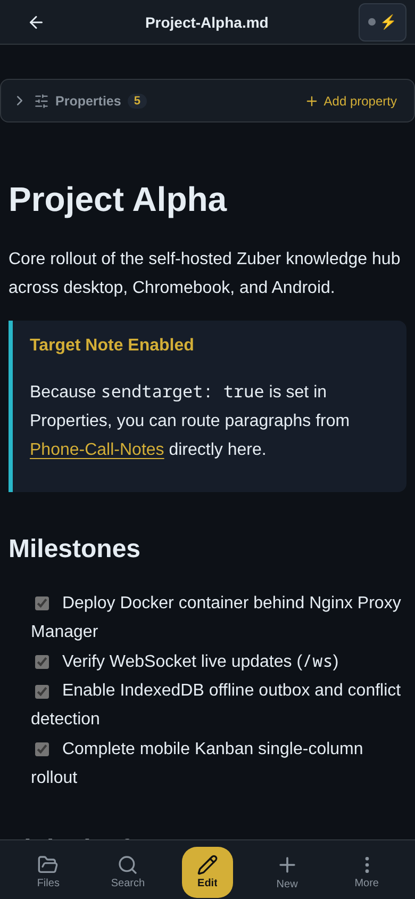
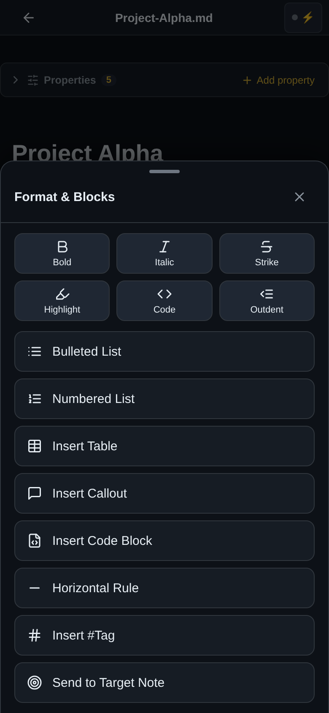
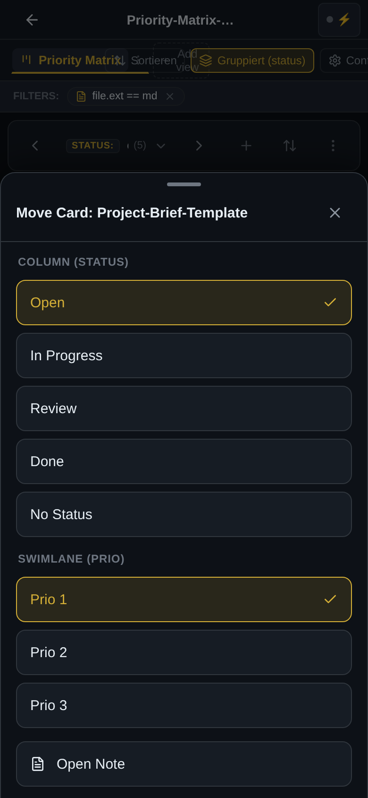

# 7. Mobile PWA & Deployment

Zuber is engineered as a **true first-class Progressive Web App (PWA)** for **Chromebooks**, **Android**, and **iOS**—eliminating the sluggishness of heavy desktop containers while preserving offline reliability and one-thumb ergonomics.

---

## 1. Mobile One-Thumb Ergonomics (`< 768px`)

On viewports narrower than `768px`, Zuber automatically switches to a touch-first mobile layout (while Desktop `>= 768px` remains completely unchanged):

- **Mobile Reading Mode Default & Double-Tap Editing:** Notes open in clean **Reading Mode** by default on mobile (configurable under **Settings → Editor & Files**). Double-tap any paragraph to jump straight into **Live-Preview** at the exact tapped coordinate; the Android Back gesture exits edit mode back to Reading Mode.
- **Slim Mobile Topbar:** Shows only the Back button (`←`), truncated file title, and compact sync status.
- **State A — Bottom Navigation Bar:** A fixed 5-button bar (`56px + env(safe-area-inset-bottom)`) with **Files**, **Search**, **Edit** (accent pill), **New (+)**, and **More (⋮)** (`<BottomSheet>` for Source/Reading toggle, Research Split, Right Sidebar, Zen Mode, Rename, Delete, and Settings).



- **State B — Keyboard-Docked Edit Bar:** Entering edit mode swaps the bottom navigation for a 7-button editing bar docked above the virtual keyboard (`Todo`, `Indent`, `Heading` sheet, `[[WikiLink]]`, `Camera/Gallery` sheet, Hybrid `+ More` formatting sheet with a 2×3 grid + tables/callouts, and `Done ✓`).



---

## 2. Mobile Single-Column Kanban & `<BottomSheet>` Controls

Horizontal multi-column Kanban scrolling is replaced on `< 768px` with a **100% full-width Single-Column Layout**:

- **Mobile Column Switcher Bar:** Displays the active column (`STATUS: Open (2)`), `‹` / `›` step buttons (`44×44px`), a dropdown trigger (`▾`) to open the **Column Selector `<BottomSheet>`**, and `+`, `⇅` (Sort), and `⋮` (Column Menu) buttons.
- **Vertical 2D Swimlanes:** On 2D boards, all swimlanes for the selected active column stack vertically at `100%` width, each with a collapsible header and a `+` button that pre-fills both the active column and swimlane.
- **Card Move & Action `<BottomSheet>`:** Tapping `⋮` (`40×40px`) on any card opens a `<BottomSheet>` to move the card to another Column (1D & 2D) or Swimlane (2D), or jump straight into the note via **Open Note**.
- **Full-Screen File-Tree Swipe Gesture:** Because mobile Kanban boards no longer scroll horizontally, swiping left-to-right anywhere on a Kanban board (or Markdown note) smoothly opens the `100vw` File Tree drawer. (Header-only swipe restriction is kept exclusively for `.canvas` panning.)
- **Android Back-Gesture (`popstate`):** Open `<BottomSheet>` overlays and sidebars close cleanly in LIFO order when pressing the system Back button.



---

## 3. Offline-First IndexedDB Outbox & Conflict Protection

Zuber caches your entire vault tree, notes, canvases, and bases in **IndexedDB**:
- Edits, new notes, folder creations, renames, and deletions performed offline are recorded in an **Outbox Queue**.
- When connectivity returns (or the WebSocket reconnects), `SyncEngine.flushOutbox()` replays your mutations in order and reconciles with the server's delta manifest (`/api/vault/sync-manifest`).
- Concurrent edits from another device are detected via `baseMtime` (`HTTP 409 Conflict`) so changes are never silently overwritten.

---

## 4. Android Web Share Target (`Inbox/`)

When installed as an Android PWA, Zuber registers as a **System Share Target**:
- Share **URLs, text snippets, Markdown files, images, or PDFs** from any Android app directly to Zuber.
- The Service Worker (`public/sw.js`) queues the payload into IndexedDB and hands it off to `shareTargetService.ts`, which saves attachments to `attachments/` and creates a clean Markdown note inside `Inbox/` with automatic deduplication.

---

## 5. Production Deployment: Docker Compose + Nginx Proxy Manager (NPM)

### Step 1: `docker-compose.yml`

```yaml
services:
  zuber:
    image: ghcr.io/wareskop/zuber:latest
    container_name: zuber
    restart: unless-stopped
    ports:
      - "3443:3443"
    environment:
      - NODE_ENV=production
      - PORT=3443
      - ENABLE_HTTPS=false      # TLS/Let's Encrypt handled by Nginx Proxy Manager
      - TRUST_PROXY=true        # Required for X-Forwarded-For & rate limiting
      - FORCE_AUTH=true         # Prevents disabling auth via the Web UI
      - MAX_UPLOAD_MB=100
      - PASSWORD=choose-a-strong-password
    volumes:
      - ./vault:/data/vault
      - ./config:/data/config
```

Start the container:
```bash
docker compose up -d
```

### Step 2: Nginx Proxy Manager (NPM)

Create a **Proxy Host** in NPM:
- **Domain Names:** e.g. `zuber.yourdomain.com`
- **Scheme:** `http` (since `ENABLE_HTTPS=false` inside the container)
- **Forward Hostname / IP:** `zuber` (if on the same Docker network) or your Docker host IP
- **Forward Port:** `3443`
- **Websockets Support:** **Enabled** (required for `/ws` live sync)
- **Block Common Exploits:** **Enabled**
- **SSL Tab:** Request a Let's Encrypt certificate and enable **Force SSL**, **HTTP/2 Support**, and **HSTS**.

---

## 6. Optional Linux `.AppImage` Desktop Build

If you prefer a standalone local Linux desktop wrapper alongside your web/PWA access, Zuber supports building a `.AppImage` package from the repository:

```bash
npm run build
# Follow the Electron / AppImage packaging workflow in package.json / scripts/
```
