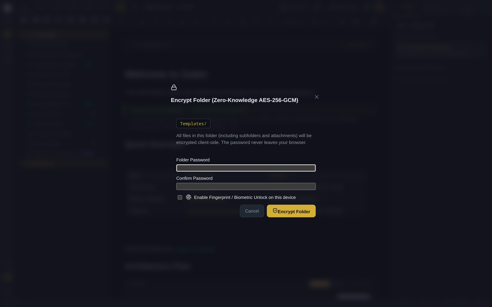

# 8. Folder Encryption & Security

Zuber includes client-side **Zero-Knowledge Folder Encryption** (`AES-256-GCM` via the Web Crypto API) so you can protect sensitive folders on your server or cloud backup without sacrificing convenience.

---

## 1. Zero-Knowledge Design (`.zenc` & `.zuber-lock.json`)

- **Client-Side Cryptography Only:** Plaintext passwords and derived `CryptoKey` instances **never** leave your browser and are never sent to the server or written to disk.
- **Key Derivation:** Uses `PBKDF2-SHA256` (`310,000` iterations, random 16-byte salt) to derive a 256-bit `AES-GCM` key per folder, verified against `.zuber-lock.json`.
- **All File Types Supported:** Every file inside an encrypted folder — `.md`, `.canvas`, `.base`, `.pdf`, images, and arbitrary binary attachments — is encrypted in-browser into `<originalName>.<ext>.zenc` (`[ZENC0001][12B IV][AES-256-GCM ciphertext + auth tag]`).

---

## 2. Locked (`🔒`) vs. Unlocked (`🔓`) States

1. **Encrypting a Folder:** Right-click (or long-press on mobile) any folder in the File Tree and choose **Encrypt Folder…**.
2. **Locked (`🔒`):** Opening any file inside a locked folder shows the **Unlock Card**, prompting for the folder password. Plaintext contents are never cached in IndexedDB while locked.
3. **Unlocked (`🔓`):** The derived `CryptoKey` is kept strictly in memory. File extensions (`.zenc`) are stripped visually in the sidebar, and Markdown notes, canvases, bases, images, and PDFs decrypt transparently on the fly.
4. **Locking & Cache Purging:** Clicking **Lock Folder** (or closing the tab) immediately clears the in-memory `CryptoKey` and purges all decrypted notes for that folder from IndexedDB.

---

## 3. Auto-Lock Timer & WebAuthn Fingerprint Unlock

- **Configurable Auto-Lock:** Under **Settings → Security**, set the inactivity **Auto-Lock Timeout** (default: `15 minutes`, or `0` to disable automatic locking).
- **WebAuthn Fingerprint / Biometric Unlock:** On supported devices (Android, macOS Touch ID, Windows Hello, Linux FIDO2), you can enroll biometric unlock when encrypting or unlocking a folder so you can re-unlock with your fingerprint instead of retyping your password.
