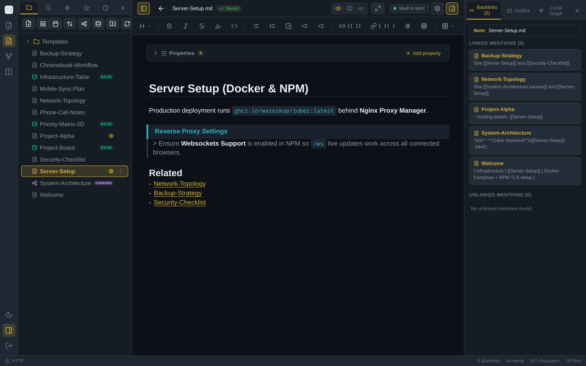

# Zuber — Personal Knowledge Base, Live-Preview Editor & Sync Engine

Welcome to the official **Zuber User Manual**. Whether you are taking quick notes on your smartphone, working distraction-free on a Chromebook, or organizing complex projects on your desktop, Zuber gives you fast, reliable access to your Markdown knowledge vault anywhere.

> **Built with AI:** This project was created using **Antigravity** and **Google Gemini**.

---

## Foreword & Origin Story

### Born Out of Practical Necessity

Zuber was created out of a very real, everyday frustration: wanting an **Obsidian-like Markdown knowledge base** without the compromises of existing setups. In practice, three pain points kept getting in the way:

1. **No built-in cross-device synchronization** without relying on third-party cloud providers, paid sync subscriptions, or fragile external file-sync tools that struggle with background mobile restrictions.
2. **Absence of a native web client** that you can simply open in any browser on any machine—whether at a desk, on a borrowed laptop, or behind a corporate firewall.
3. **Sluggish performance on Chromebooks and mobile devices** when running heavy desktop Electron/containerized apps or dealing with slow startup times when you just need to jot something down immediately.

### Inspired by Obsidian — Not a Replacement

Let's be clear about what Zuber is and what it is not:

> **Zuber is inspired by Obsidian — it is not intended to be a full-blown replacement for Obsidian**, nor does it try to replicate Obsidian's massive third-party plugin ecosystem.

Instead, Zuber focuses on Obsidian's core strengths: **keeping 100% of your notes as plain, human-readable Markdown (`.md`) files with YAML frontmatter and standard JSON Canvas (`.canvas`) / Base (`.base`) files on your own disk or server.** Because your data stays in open, standard formats inside a regular folder (`vault/`), you retain full ownership and can even open the exact same folder in Obsidian Desktop whenever you want—while using Zuber to access, edit, and organize your vault from anywhere like a modern cloud app.

### The "Zuber" Metaphor — Your Tailored Personal Knowledge Vault

In German, a **Zuber** is a traditional, sturdy wooden tub with two handles—a practical catch-all vessel. That is exactly how Zuber is designed to work for your mind:

- **Throw ideas in effortlessly:** Capture fleeting thoughts, phone call notes, web shares from Android, system diagrams, and project tasks without friction.
- **Organize when ready:** Sort, link, tag, and structure your notes later using Kanban boards, 2D swimlane matrices, databases, and Wiki-links.
- **Carry it everywhere:** Enjoy seamless multi-device synchronization across **Desktops**, **Chromebooks** (without compromises), and **Android/iOS smartphones**, backed by **automatic Git version history** and **one-click file restoration** so no thought is ever lost.

---

## Architecture & Offline-First Philosophy

Zuber combines a lightweight **Node.js + Express + WebSocket** backend with an **Offline-First Progressive Web App (PWA)** frontend:

- **In-Memory Vault Index (`VaultService`):** The server indexes your entire vault in RAM on startup and keeps it incrementally updated via a filesystem watcher (`chokidar`), delivering instant search, backlinks, and graph queries in milliseconds.
- **IndexedDB Offline Cache & Outbox:** Your browser caches notes, canvases, bases, and the folder tree locally in IndexedDB. Even if your train enters a tunnel or your Wi-Fi drops, you can keep reading, editing, creating notes, and moving Kanban cards. As soon as you are back online, Zuber's Sync Engine automatically flushes your queued changes to the server.
- **Real-Time Live Updates:** Changes saved on one device (or externally on the server disk) are broadcast via WebSockets (`/ws`) to all connected clients.
- **Self-Hosted Security:** Single-user authentication with `scrypt` password hashing, `HMAC-SHA256` session tokens, rate limiting, DOMPurify HTML sanitization, and containerized Git remote backups over HTTPS.



---

## Quick-Start Guide

### 1. Run Locally or via Docker Compose

The fastest way to run Zuber on a home server, NAS, or VPS is with Docker Compose:

```yaml
services:
  zuber:
    image: ghcr.io/wareskop/zuber:latest
    container_name: zuber
    restart: unless-stopped
    ports:
      - "3443:3443"
    environment:
      - NODE_ENV=production
      - PORT=3443
      - ENABLE_HTTPS=false   # Let Nginx Proxy Manager handle TLS/Let's Encrypt
      - TRUST_PROXY=true
      - FORCE_AUTH=true
      - PASSWORD=your-strong-password
    volumes:
      - ./vault:/data/vault
      - ./config:/data/config
```

For full deployment instructions (including **Nginx Proxy Manager** and the **Linux AppImage** build), see **[Chapter 7: Mobile PWA & Deployment](07-Mobile-PWA-and-Deployment)**.

### 2. Essential Keyboard Shortcuts

| Shortcut | Action |
| :--- | :--- |
| `Ctrl+P` / `Cmd+P` | Open **Command Palette** |
| `Ctrl+O` / `Cmd+O` | Open **Quick Switcher** (jump to any note) |
| `Alt+←` (`Alt+ArrowLeft`) | **Go Back** in navigation history (or Research Split history) |
| `Alt+D` | Open or create today's **Daily Note** |
| `Alt+Z` | Toggle distraction-free **Zen Mode** |
| `Ctrl+Shift+F` | Open **Unified Full-Text Search** (`+`/`-`, `*` wildcards, `?` syntax help) |
| `Ctrl+F` / `Cmd+F` | Open floating **In-Note Jump Bar** (`▲` / `▼` match navigation) |
| `Ctrl+\` | Toggle **Left Sidebar** (File Tree) |
| `Ctrl+Alt+\` | Toggle **Right Sidebar** (Backlinks, Outline, Local Graph) |
| `Ctrl+.` / `Cmd+.` | Insert current timestamp (`YYYY-MM-DD HH:mm:ss`) |

---

## Manual Chapters

1. **[Markdown Editor & Workflows](01-Markdown-Editor-and-Workflows)** — Live-Preview, Reading & Source modes, Visual Properties, Callouts, Blockquotes with preserved multi-line breaks, Mermaid & HTML blocks, Inline PDFs, Image toolbar, Send to Target Note (`sendtarget: true`), Templates (`isTemplate: true`), and Zen Mode.
2. **[Research Split-View](02-Research-Split-View)** — Asymmetric 70/30 Split-View, undisturbed writing in the primary pane, smart click-routing vs. `Alt+Click`, Ad-Free Web Reader (`[ Markdown | HTML ]` toggle & **Save as Note**), Offline PDF Text-Layer Viewer (`pdf.js`), Drag & Drop blockquotes + `Insert as Quote ↵` popover, automatic Back-button and Mentions sync, mobile vertical split, and Zen split divider.
3. **[Bases, Dashboards & Kanban](03-Bases-Dashboards-and-Kanban)** — `.base` databases, Table & Card views, visual filter chips, 1D Kanban boards, 2D Swimlane matrices, card properties, column sorting, and live `![[File.base]]` dashboards.
4. **[Canvas & Visual Diagrams](04-Canvas-and-Visual-Diagrams)** — JSON Canvas 1.0 editor, 11 workflow & network shapes (icon-only picker), switchable Compact Card vs. Preview `.md`/`.pdf` file nodes with remembered dimensions, `+ New Note` inline creation & Sidebar/OS file drops, `<Canvas>.canvas.assets/` Companion Folder & Virtual Sidebar Tree, image Drag & Drop / Paste / Shapes / Clickable Links, enlarged mouse/touch handles, `![[Diagram.canvas]]` embeds, and Canvas Presentation Mode.
5. **[Navigation, Graph & Search](05-Navigation-Graph-and-Search)** — File tree multi-select, Drag & Drop / *Move to…*, additive Auto-Reveal & scroll-to-top from Favorites/Recents/Wiki-Links (never collapsing open folders), expandable `.canvas` companion trees, collapsible Global External Links panel, vault-wide link refactoring across `.md` & `.canvas`, Unified 4-Mode Search (`+`/`-`, `*` wildcards, In-Note Jump Bar), Command Palette, and 2D Knowledge Graph.
6. **[Git Versioning & History](06-Git-Versioning-and-History)** — Containerized Git engine, auto-commits on note leave & session close, HTTPS remote backup, per-file Version History (`git log --follow`), color-coded Diff Viewer, and one-click restore.
7. **[Mobile PWA & Deployment](07-Mobile-PWA-and-Deployment)** — Chromebook & smartphone ergonomics, compact mobile Canvas icon toolbar, Mobile Reading Mode, Bottom Navigation Bar, Keyboard-Docked Edit Bar, `+ New ▾` touch toolbar, single-column mobile Kanban & `<BottomSheet>` controls, Offline IndexedDB Outbox, Diagnostics & Debug Log Export, Android Web Share Target (`Inbox/` with `YYYY-MM-DD` prefix), First-Install Demo Vault Seeding, Docker + NPM, and Linux AppImage.
8. **[Folder Encryption & Security](08-Folder-Encryption-and-Security)** — Zero-Knowledge client-side `AES-256-GCM` `.zenc` folder encryption for all file types, per-folder passwords, auto-lock + IndexedDB cache purging, and optional WebAuthn fingerprint/biometric unlock.
