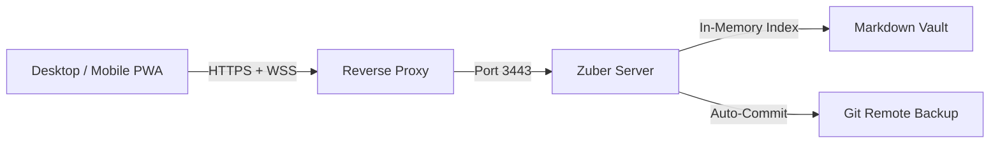

---
tags:
  - welcome
  - dashboard
  - guide
aliases:
  - Home
  - Start
status: active
---

# Welcome to Zuber

Zuber is your self-hosted, **offline-first Markdown knowledge base and visual workspace**. All notes remain standard `.md`, `.canvas`, and `.base` files on disk, synced in real time across Desktop, Chromebook, and Android/iOS via Progressive Web App (PWA) + Git.

> [!TIP] Quick Start & Navigation
> - **Command Palette / Quick Open:** `Ctrl + P` or `Ctrl + O`
> - **Search:** `Ctrl + Shift + F` (vault-wide) or `Ctrl + F` (in note)
> - **Research Split-View:** Click any link while Research View is open (or toggle it in the topbar), `Alt + Click` to open in the main editor
> - **Distraction-Free Zen Mode:** `Alt + Z`

## Interactive Demo Guides

| Guide | Topic |
| :--- | :--- |
| [[01 - Markdown & Visual Tables]] | Live-Preview, callouts, in-place Excel-style table editing, `_tableWidths` & sorting |
| [[02 - Bases & Kanban Boards]] | 1D Kanban, 2D Swimlane Matrix, and filtered database tables |
| [[03 - Visual Canvas & Workflows]] | JSON Canvas 1.0 diagrams with network/workflow shapes and embedded notes |
| [[04 - Research Split-View & Embedded Web]] | Asymmetric 70/30 split view, integrated web browser & `Send to Target Note` |
| [[05 - Folder Encryption & Security]] | Zero-knowledge AES-256-GCM `.zenc` folder encryption & WebAuthn fingerprint unlock |
| [[06 - Mobile PWA & Daily Notes]] | 4-in-1 mobile search, `+ New ▾` touch menu, daily notes & Android Web Share |

## System Overview

## Live Embedded Project Board

![[Project-Board.base]]

## Live System Architecture Canvas

![[Architecture-Workflow.canvas|360]]
